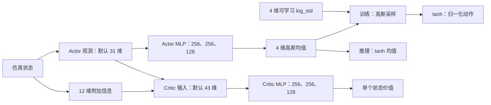
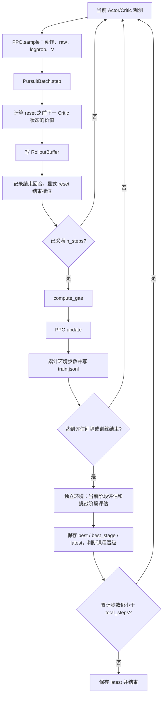
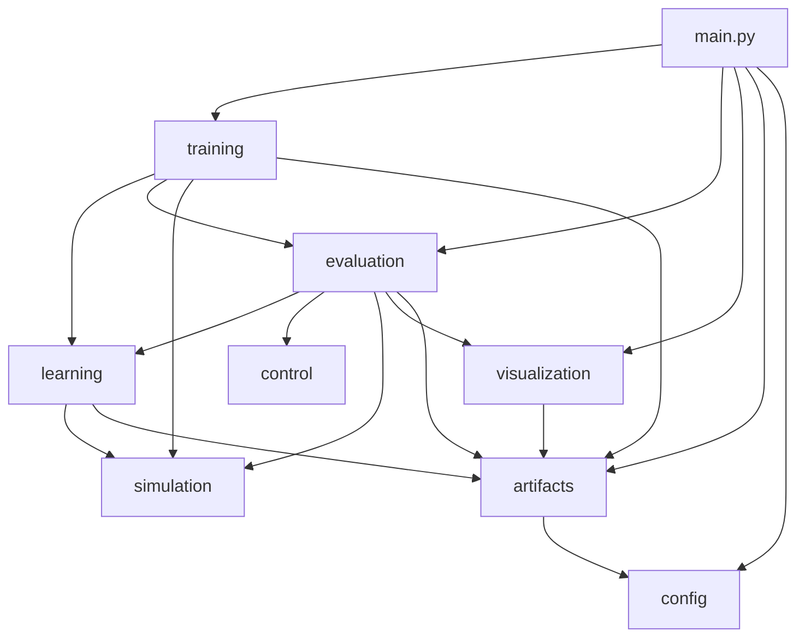

# Pursuit RL 当前代码解读：文件职责、模型组成与依赖关系

适用版本：6.3.0。核对日期：2026 年 10 月 16 日（Asia/Shanghai）。代码根目录：`C:\Users\53199\Desktop\pursuit_rl_v5`。

本说明依据当前源码、默认 YAML 和函数导入关系编写，覆盖全部 **55 个 Python 文件、5 个 Shell 脚本、8 个 YAML 配置文件**，以及安装配置、源码清单和实验产物的用途。`runs` 中的模型、轨迹和历史配置属于实验数据，不作为可执行源码逐一展开；编辑器设置和缓存不在代码解读范围内。

建议先读第 1～4 节理解任务和模型，再按第 8 节查阅具体文件。第 7 节的箭头表示导入依赖，第 4～5 节的箭头表示执行顺序或数据流，两种关系需要分开理解。

## 目录

1. [项目实际解决什么问题](#section-1)
2. [神经网络组成、观测与动作](#section-2)
3. [仿真模型、事件与奖励](#section-3)
4. [一次训练如何执行](#section-4)
5. [评估、比较与离线分析如何执行](#section-5)
6. [配置对象如何形成](#section-6)
7. [模块依赖与关键对象关系](#section-7)
8. [全部 Python 文件逐项说明](#section-8)
9. [配置、脚本与工程文件](#section-9)
10. [实验结果和数据格式](#section-10)
11. [运行示例与阅读路线](#section-11)
12. [常见修改应落在哪些位置](#section-12)
13. [文档核对方法与当前实现边界](#section-13)

<a id="section-1"></a>

## 1. 项目实际解决什么问题

这是一个批量无人机追踪拦截仿真项目。追踪方通过强化学习策略或解析制导控制器，在速度、倾角和空间限制内接近目标；相对运动首次进入当前课程阶段指定的捕获球时判定成功。

目标不是另一架由神经网络控制的四旋翼，而是由 `TargetBatch` 生成的运动学机动体。当前项目没有双智能体对抗训练：只有追踪方的 PPO 网络被优化，目标运动来自预设随机规则。

程序包含三类不同的“模型”：

| 模型 | 实现 | 是否学习参数 | 作用 |
| --- | --- | --- | --- |
| 策略与价值网络 | AsymmetricPPO | 是 | Actor 产生动作，Critic 估计状态价值 |
| 追踪机动力学 | QuadrotorBatch | 否 | 根据推力和机体系角速度指令推进位置、速度、姿态 |
| 目标运动模型 | TargetBatch | 否 | 生成 straight、Singer、Dubins、hybrid 运动 |

PD、PN、APN 是评估用的解析控制器，不是 PPO 的教师，也不参与 PPO 参数更新。代码没有模仿学习数据集加载流程；训练样本由仿真环境在线生成。

```text
用户参数 / YAML
       ↓
main.py：确定任务、配置、模型与输出位置
       ├── train → Trainer → PPO + PursuitBatch → checkpoint / 训练记录
       ├── evaluate → PPO 或 GuidanceController → 回合报告 / 可选轨迹
       ├── benchmark → 多控制器 × 多场景 → 轨迹、指标、汇总
       └── 分析命令 → 读取已有报告或轨迹 → 图表、比较、CSV、ZIP
```

<a id="section-2"></a>

## 2. 神经网络组成、观测与动作

### 2.1 非对称 Actor–Critic 的含义

`AsymmetricPPO` 是一个 PyTorch `nn.Module`，内部包含独立的 Actor MLP、Critic MLP 和 4 个可学习的 `log_std` 参数。两个网络不共享隐藏层。

Actor 的输入是策略观测；Critic 的输入是“策略观测 + 12 维附加仿真信息”。这种输入不对称使价值估计可以使用训练时的额外状态。执行策略时，`predict()` 和 `act()` 只经过 Actor，Critic 不参与动作生成。



### 2.2 当前网络的精确结构

隐藏层均为 `Linear + ELU`，最后一层为线性层。Actor 的 tanh 在网络外部的采样/预测函数中执行，Critic 输出不经过 tanh。

```text
默认 Actor：31 → 256 → ELU → 256 → ELU → 128 → ELU → 4
默认 Critic：43 → 256 → ELU → 256 → ELU → 128 → ELU → 1
默认 log_std：长度为 4 的向量；与状态无关，跨所有环境槽共享

smoke Actor：31 → 32 → ELU → 32 → ELU → 4
smoke Critic：43 → 32 → ELU → 32 → ELU → 1
```

下面的参数量由实际构造的 PyTorch 模型统计，包含线性层偏置，不包含优化器状态：

| 配置 | Actor 参数 | Critic 参数 | log_std 参数 | 总参数 |
| --- | --- | --- | --- | --- |
| 默认配置 | 107,396 | 110,081 | 4 | 217,481 |
| smoke.yaml | 2,212 | 2,497 | 4 | 4,713 |

当 `observation.boundary_features=true` 时，Actor/Critic 输入分别变为 34/46 维；隐藏层宽度取决于解析后的配置。以上 31/43 维和默认网络宽度不是对所有历史 checkpoint 的硬编码承诺，读取 checkpoint 时会按保存的配置构建网络。

### 2.3 Actor 的 31 维观测逐项说明

下标采用 Python 的左闭右开区间。`rot` 表示从机体系到世界系的旋转，`body_frame` 将世界系向量转回机体系。

| 特征 | 默认切片 | 维数 | 编码及作用 |
| --- | --- | --- | --- |
| 目标相对位置 | `[0:3]` | 3 | 机体系下目标位置减追踪机位置，除以 distance_scale |
| 目标相对速度 | `[3:6]` | 3 | 机体系相对速度，除以 speed_scale |
| 目标加速度 | `[6:9]` | 3 | 机体系目标真实仿真加速度，除以 target_accel_scale |
| 追踪机速度 | `[9:12]` | 3 | 机体系追踪机速度，除以 speed_scale |
| 姿态 | `[12:21]` | 9 | 3×3 旋转矩阵展平，提供世界方向和姿态信息 |
| 机体系角速度 | `[21:24]` | 3 | 当前响应后的角速度，按最大角速度尺度归一化 |
| 上一动作 | `[24:28]` | 4 | 上一控制周期的归一化推力/角速度指令 |
| CPA 距离与时间 | `[28:30]` | 2 | 有限时域最近接近距离、时间，分别归一化 |
| 剩余时间比例 | `[30:31]` | 1 | 当前阶段的剩余时间 / 总时限 |
| 可选边界向量 | `[31:34]` | 3 | 到所选最近水平/垂直边界的有符号向量，转机体系并归一化 |

`use_cpa=false` 时，两个 CPA 特征清零，不删除维度。`boundary_features=true` 才实际追加 3 维。当前编码直接使用仿真真值，包含目标加速度；“Actor 输入较少”不等于“已经实现真实传感器、噪声滤波或目标状态估计”。

### 2.4 Critic 额外的 12 维

Critic 在完整 Actor 向量后追加：归一化真实滤波推力 1 维、响应后的角速度 3 维、阻力系数比例 1 维、角速度响应时间常数比例 1 维、推力响应时间常数比例 1 维、质量比例 1 维、目标运动模式 one-hot 4 维。

其中角速度在 Actor 中也出现，但 Critic 附加向量使用自己的比例编码。四种目标模式的顺序由 `MODES` 决定：straight=0、singer=1、dubins=2、hybrid=3。

### 2.5 四维动作与物理指令

网络动作形状为 `(N, 4)`，范围为 `[-1, 1]`，四个通道依次是 collective、roll rate、pitch rate、yaw rate。

```text
thrust_cmd = clip(hover_thrust + thrust_delta × action[0], thrust_min, thrust_max)
rate_cmd   = action[1:4] × [rate_xy, rate_xy, rate_yaw]
```

默认 `hover_thrust=9.81`、`thrust_delta=15`，角速度尺度为 `[1.2, 1.2, 1.0]` rad/s。`thrust` 在这份模型中按加速度尺度使用，随后除以随机质量比例，并不是直接输出四个电机转速或以牛顿为单位的总力。零动作在名义参数、水平姿态下对应悬停推力和零角速度指令。按默认数值，归一化动作的有效推力上限是 min(30, 9.81+15)=24.81，而不一定能达到配置的 thrust_max=30。

### 2.6 PPO 实际如何更新

训练时，Actor 输出高斯均值 `μ`，标准差是 `exp(log_std)`；先采样 `raw=μ+σ×ε`，再令 `action=tanh(raw)`。缓冲区保留 raw，计算动作对数概率时减去 tanh 变换的 Jacobian 修正项。

`update()` 把 `(T,N,...)` 展平，标准化优势，打乱索引并按 batch_size 多轮更新。Actor 使用 PPO clipped surrogate；Critic 使用 `0.5 × mean((V-return)²)`。两个 Adam 优化器分别更新 Actor（包括 log_std）和 Critic。

默认更新参数是 gamma=0.999、GAE lambda=0.95、clip=0.2、4 epochs、Actor 学习率 0.0003、Critic 学习率 0.0009、梯度裁剪阈值 0.5。近似 KL 超过 `1.5 × target_kl` 时提前停止本轮更新；每次 Actor 更新后把 log_std 限制到 `[-4,1]`。

日志中的 entropy_proxy 是未经过 tanh 的高斯熵代理，不是严格的压缩动作分布熵。当前实现没有共享骨干、RNN、注意力层、经验回放池或目标网络；这里的 `RolloutBuffer` 只保存当前一轮 on-policy 样本。

<a id="section-3"></a>

## 3. 仿真模型、事件与奖励

### 3.1 坐标、时间和批处理

世界系为 NED：北、东、向下；机体系为 FRD：前、右、向下。高度等于 `-pos_z`。图表为了阅读方便把 Z 取反显示为高度，不改变训练坐标。

默认每个控制周期 dt=0.05 秒，即 20 Hz。追踪机动力学在每周期内再分 5 个子步积分，每子步 0.01 秒；目标按控制周期推进。环境的主要状态带批维 N，例如位置 `(N,3)`、姿态 `(N,3,3)`。默认 N=64，smoke 配置为 N=4；“64 并行”不是类本身固定只能运行 64 个环境。

`PursuitBatch.step()` 返回：

```python
((actor_obs, critic_obs), reward, terminated, truncated, info)
# actor_obs: (N, actor_dim)，critic_obs: (N, critic_dim)
# reward: (N,)，terminated/truncated: (N,) 布尔数组
# info: 长度 N 的列表；未结束槽位是 {}，结束槽位是回合记录
```

它是项目自己的批量接口，不是继承 Gymnasium Env 的标准封装。环境不会自动 reset；训练循环明确重置已结束的槽位，避免丢掉超时最后状态的价值。

### 3.2 追踪机动力学

`QuadrotorBatch.step()` 对推力和角速度分别应用一阶滞后，使用指数映射 `exp_so3` 更新旋转矩阵。加速度由负机体 Z 轴方向的推力、NED 重力和二次速度阻力组成，再更新速度、位置。

每次随机重置会扰动阻力系数（名义值的 0.8～1.2 倍）、两种响应时间常数（0.85～1.15 倍）和质量比例（0.95～1.05）。这是仿真域随机化，Critic 的附加特征可以看到这些实际参数。

虽然注释称 6DoF，这里采用“推力/角速度指令的一阶响应 + 平移/姿态推进”模型；没有逐电机混控、转子空气动力、完整刚体力矩方程或飞控硬件接口。

### 3.3 目标运动

| 模式 | 代码含义 |
| --- | --- |
| straight | 没有该模式专属的机动加速度；仍经过公共边界回拉、速度管理逻辑 |
| singer | 使用 OU 过程生成相关随机加速度，再受阶段加速度上限约束 |
| dubins | 按有界转率改变航向，构造近似定速转弯的期望速度 |
| hybrid | 分段选择期望加速度，平滑转向；支持 random、switchback、pulse 模式 |

运动模式在一个回合中保持；分段变化的是机动加速度等参数，不是每段重新选择模式。`strict_speed_ceiling=true` 会缩放本步加速度，使下一速度处于设定速度球内；false 时只有公共速度管理逻辑，不应把它解读为严格逐步速度上限。

### 3.4 终止与截断

成功由上一周期和本周期相对位置之间的线段是否首次进入捕获球决定，可计算周期内插值比例和 reach_time。它能捕捉“两个采样端点都在球外，但中间穿过球”的情况；仍属于控制周期内的线性近似，不是完整连续动力学求根。

物理失败包括超速、越界（水平工作区或高度范围）和超倾角。同一控制周期中成功优先；失败原因的选择顺序是 success、speed、outside、tilt、timeout。

- `terminated`：成功或物理失败，MDP 终止。
- `truncated`：到时限且没有 terminated，作为时间截断。
- 在线记录的 minimum_distance 是采样距离最小值；离线 min_distance 还检查线段内部最小距离，二者可能不同。

### 3.5 奖励由哪些项构成

`compute_reward()` 在事件分类后只计算一次，返回总奖励及分项字典，训练日志保存分项均值。

| 分项键 | 含义 | 默认权重 |
| --- | --- | --- |
| distance | 距离惩罚，距离 / distance_scale | 0.5 |
| closing | 闭合速度奖励，按 speed_scale 归一化并裁剪 | 0.25 |
| cpa | 默认惩罚有限时域 CPA 距离；也支持势函数差分 | 0.25 |
| action_delta | 连续动作变化的平方和惩罚 | 0.01 |
| time | 每周期固定时间成本 | 0.03 |
| speed_risk | 接近速度上限的软风险 | 0.05 |
| tilt_risk | 接近倾角上限的软风险 | 0.05 |
| boundary_risk | 接近当前空间边界的软风险 | 0.0 |
| predictive_risk | 按当前位置和速度外推后接近边界的风险 | 0.0 |
| precision | 近距离指数势函数差分，鼓励精确接近 | 0.15 |
| terminal | 成功加 30；未成功的物理失败减 12 | 独立奖励参数 |

距离、闭合、direct CPA、时间和软风险等常规项按 dt 缩放；势函数差分和终止奖励不是同样的 dt 积分项。`precision` 的势是 `exp(-distance/precision_scale_m)`，CPA potential 的势是负归一化 CPA 距离。

势函数奖励采用 `weight × (gamma × 当前势 - 上一势)`；真正 terminated 时当前势置零，超时截断时保留。默认 cpa_mode=direct，所以默认 CPA 项是距离成本，不是 potential。`w_cpa=0` 只关闭 CPA 奖励，不关闭 CPA 观测，也不关闭 precision 奖励。

<a id="section-4"></a>

## 4. 一次训练如何执行

### 4.1 初始化链路

```text
main.main → build_parser → execute → run_train
    → Config.from_args：解析和校验配置
    → Experiment.plan / find_experiment：确定实验目录
    → Trainer.__init__：空目录或恢复身份检查
    → ExpLogger：创建独立会话、记录输入
    → Trainer._initialize：设置种子、创建网络和环境、加载权重/恢复
    → 写 config.yaml、初次 run.json、实验身份
    → Trainer.run → Trainer._run
```

配置对象在边界处转成独立字典，供数值计算模块使用。Trainer 持有 model、env、obs/priv、累计步数、课程状态、最好分数和日志对象。构造 Config、规划 Experiment 本身不创建实验目录。

### 4.2 采样、GAE 和 PPO 的循环



默认一次 rollout 采集 `256 × 64 = 16,384` 条转换。`steps` 是所有环境槽位累计的转换数，不是网络更新次数，也不是单环境仿真时钟。total_steps 按整段 rollout 推进，最终实际 steps 可能略大于请求值。

`RolloutBuffer` 保存 obs、priv、raw、旧 logprob、V、reward、next_values、terminated、truncated、advantage、returns。GAE 的实际掩码是：

```text
δ_t = r_t + gamma × (非 terminated_t) × V(next_state_t) - V(state_t)
A_t = δ_t + gamma × lambda × (非 terminated_t 且非 truncated_t) × A_(t+1)
return_t = A_t + V(state_t)
```

成功和物理失败不 bootstrap。时间截断使用 reset 前最后状态的价值 bootstrap，但优势递推不跨入 reset 后的新回合。单纯采样到 rollout 末尾也不等于环境终止。

### 4.3 验证、最好模型与课程晋级

Trainer 定期建立独立评估环境，当前阶段评估用于晋级，max_stage 阶段的挑战评估用于全局 best。模型以确定性 Actor 动作评估，不把评估样本用于梯度更新。

排序标准是 `(成功率, -mean_capped_time)`：先比较成功率，再比较 capped 时间。best.pt 是挑战阶段最好模型；best_stageK.pt 是对应阶段最好模型；latest.pt 是最近保存的恢复状态，三者含义不同。

晋级要求在当前阶段停留足够的累计环境步数，并连续达到指定成功率门槛。默认最少 262,144 步、成功率 0.8、连续 2 次；达到 max_stage 后不再晋级。晋级会重置训练环境并刷新观测。

默认课程如下；所有阶段都可由 YAML 覆盖，stage 参数使用从 0 开始的索引：

| 索引 / 名称 | 目标模式 | 初距 m | 目标速度 m/s | 时限 s | 加速度上限 m/s² | 捕获半径 m |
| --- | --- | --- | --- | --- | --- | --- |
| 0 / stage0 | straight | 10.0～30.0 | 0.0～5.0 | 40.0 | 2.0 | 5.0 |
| 1 / stage1 | straight、dubins | 30.0～100.0 | 4.0～10.0 | 60.0 | 3.0 | 5.0 |
| 2 / stage2 | straight、dubins、singer | 100.0～300.0 | 8.0～20.0 | 90.0 | 5.0 | 5.0 |
| 3 / stage3 | straight、dubins、singer、hybrid | 100.0～500.0 | 10.0～25.0 | 120.0 | 7.0 | 5.0 |
| 4 / precision_3m | straight、dubins、singer、hybrid | 100.0～500.0 | 10.0～25.0 | 120.0 | 7.0 | 3.0 |
| 5 / precision_2m | straight、dubins、singer、hybrid | 100.0～500.0 | 10.0～25.0 | 120.0 | 7.0 | 2.0 |
| 6 / precision_1m | straight、dubins、singer、hybrid | 100.0～500.0 | 10.0～25.0 | 120.0 | 7.0 | 1.0 |

### 4.4 三种模型使用方式

| 方式 | 入口 | 保留内容 | 主要约束 |
| --- | --- | --- | --- |
| 推理 | load_model / evaluate / benchmark | 网络权重及读取后的模型配置 | 支持已登记的当前/历史 schema，检查策略契约；不创建优化器 |
| 新实验初始化 | train --init-from | 从旧 checkpoint 载入网络参数，记录来源 | 优化器、步数和最好分数重置；观测/动作契约和网络拓扑兼容 |
| 继续训练 | train --resume | 网络、优化器、计数、课程和最好分数等 | 当前 checkpoint/reward 版本和配置哈希一致，恢复输出身份合法 |

恢复时未完成回合会重采样。保存了一部分 RNG 状态，但不是仿真全状态快照，因此不承诺逐随机数、逐动作完全相同的恢复。改变总步数或奖励会改变配置哈希，当前实现应使用新实验和 --init-from，而不是直接覆盖原配置继续 resume。

<a id="section-5"></a>

## 5. 评估、比较与离线分析如何执行

### 5.1 evaluate 和 benchmark 的分工

`evaluation/rollout.py` 是共同的在线 rollout 实现：给它任意实现 `act(env, obs)` 的控制器，就能按固定种子运行指定数量回合。一次最多 64 个槽位，大于 64 回合时顺序分批，每批使用 seed+start。各槽位完成后只记录第一次终止，不把后续状态计入该回合结果。

`evaluate` 子命令默认输出完整回合报告；指定 --save-traces 或 --trace-dir 才保存逐步轨迹。它评估某个训练配置阶段，不提供 --scenarios 参数。

`benchmark` 在公共 rollout 外编排“控制器 × 场景”，总是保存所需轨迹，再逐回合计算离线指标，检查线上成功/首达时间与离线结果一致，最后生成协议、统计表和可选图表。只有所有任务完成后才写 complete.json。

### 5.2 配置阶段与命名测试场景

- `--stage`：使用给定配置或模型配置中的阶段。
- benchmark 的 `--scenarios`：使用独立命名测试分布；与 --stage 互斥。
- 两者都省略时，按解析配置的 training.max_stage 评估，不等于自动选择 standard 场景。

命名场景会从默认配置重置 physics、target、curriculum，再添加该场景覆盖，保留 checkpoint 的输入编码和相关尺度。因此训练中改过某个任务分布，不会悄悄改变标准 holdout；plant_lag 等显式场景仍可有意改变被测物理条件。

| 名称 | 场景含义 |
| --- | --- |
| `ood_random_2m` | hybrid，300～500 m、18～25 m/s、150 s、9 m/s²、2 m，快速随机机动。 |
| `ood_switchback_2m` | 上述 2 m OOD 分布，横向交替机动。 |
| `ood_pulse_2m` | 上述 2 m OOD 分布，纵向脉冲机动。 |
| `standard` | 标准 stage3 分布，默认 5 m 半径。 |
| `far_fast` | 350～500 m、18～25 m/s。 |
| `edge_fast` | 400～500 m、22～25 m/s。 |
| `long_180s` | 350～500 m、18～25 m/s，时限 180 s。 |
| `rapid_hybrid` | 仅 hybrid，0.5～1.5 s 间隔。 |
| `singer_fast` | 仅 Singer，sigma=6。 |
| `plant_lag` | 推力/角速度滞后和阻力增大。 |
| `high_accel_rapid` | 10 m/s² 加速度上限和快速机动组合。 |
| `precision_2m` | 标准分布，半径 2 m。 |
| `precision_3m` | 标准分布，半径 3 m。 |
| `precision_1m` | 标准分布，半径 1 m。 |
| `overtaking_edge` | 同向追赶、远距离高速。 |
| `head_on_edge` | 迎头相遇、远距离高速。 |
| `crossing_edge` | 交叉相遇、远距离高速。 |
| `switchback_hybrid` | hybrid 横向交替，0.5～1.5 s 间隔。 |
| `pulse_hybrid` | hybrid 沿速度方向交替加速/制动。 |
| `strict_target_speed` | 强制目标最大速度球约束。 |
| `high_corr_singer` | Singer alpha=0.3、sigma=5。 |

### 5.3 解析控制器的组成

`GuidanceController` 用统一 act 接口封装 PD、PN 和 APN。PN 根据视线角速度构造横向制导加速度；APN 在其上增加目标横向加速度补偿。两者还使用相同的纵向速度追赶律，因为纯 PN 本身并不负责建立闭合速度。

生成的世界系期望加速度经 acceleration_to_action 转成推力和机体系角速度指令，包含阻力/重力补偿、期望姿态和倾角限制。默认参数保存在 GuidanceParameters 中，包括 N=3、Na=1、速度比例 0.85、闭合速度目标上限 8 和加速度上限 10。PD 是诊断性近似控制器，不等价于 PN/APN 的完整映射流程。

### 5.4 离线指标和比较

| 类别 | 主要输出 | 读取什么 |
| --- | --- | --- |
| 任务 | success、capture_time、min_distance、capped_time、reason | 相对轨迹和权威终止元数据 |
| 机动 | lateral_accel_cost、control_variation、横向加速度均方 | 实际时间间隔、速度、动作 |
| 包线 | 速度/倾角利用率、载荷峰值与 RMS、高载荷占比 | 速度、姿态、真实滤波推力对应载荷 |
| CPA | initial_cpa、final_cpa、mean_cpa | 目标与追踪机的位置、速度 |
| 汇总 | 成功率、Wilson 区间、均值及有效样本数、限定时间内捕获率 | 多回合指标记录 |

成功回合 capped_time 是首达时间，失败回合是任务 time_limit，而不是失败发生时刻；因此它会同时反映成功与未完成任务的成本。成功时间均值只统计有捕获时间的回合，缺失值保留为 None，不填成 0。

机动成本按保存的真实时间间隔计算，当前统计范围为整段已保存的采样轨迹，不强行截短到周期内插值首达时刻。control_variation 对当前格式轨迹排除 reset 状态到第一条指令的跳变。

`compare` 比较的是含 episodes_detail 和 evaluation_protocol 的两个回合报告或两个算法/场景目录，不是 benchmark 根目录的汇总列表。它先检查协议、任务哈希、批大小、种子、回合 ID 和初态一致，再统计双方胜负/共同成功，并计算精确 McNemar p 值。

`feasibility` 用初始相对位置、目标速度和追踪方最大速度解理想匀速拦截方程。它忽略加速度、转弯、边界等限制，只是理想几何诊断，不是对机动目标的可达性证明。

<a id="section-6"></a>

## 6. 配置对象如何形成

`config/defaults.yaml` 是唯一完整默认配置。根目录 configs 下的 YAML 通常只声明差异，不复制整份默认值。`Config` 是只读 Mapping，也支持属性访问。

```python
from pursuit_rl.config import Config

cfg = Config.load("configs/smoke.yaml")
print(cfg.training.num_envs)              # 4
new_cfg = cfg.with_overrides({"training": {"num_envs": 8}})
plain = new_cfg.to_dict()                 # 独立、可修改的普通字典
```

`Config.from_args` 的实际选择顺序分两步理解：

1. 先选基底：显式 YAML 优先；恢复且没有显式 YAML 时找 checkpoint 所属目录的 config.yaml；其后可用调用方提供的 checkpoint 配置回退；没有回退但提供 --run 时读实验配置；都没有时用默认配置。显式 YAML 从默认契约解析，不是把任意 checkpoint 所有字段先混入再覆盖。
2. 再应用重复 --set；最后只对 train 应用显式 seed、device、total_steps、num_envs 参数。评估的 --seed 是评估种子，不改模型训练 seed。

extends 按相对 YAML 路径读取父配置，检测继承环。stages 按阶段名字查找并合并字段；curriculum 列表整体替换。未知字段、错误类型、物理范围和阶段范围在边界处报错。

ConfigNode 递归冻结嵌套映射与列表；需要修改时返回新 Config 或 to_dict 副本。保存使用普通 YAML，device 保存 cpu/cuda 字符串。显式 auto 才探测 CUDA，默认 cpu 不会被自动覆盖。

配置哈希覆盖解析后的算法/仿真配置，不包括日期、结果路径和日志路径。它与 policy_contract、task_hash 分工如下：

| 标识 | 覆盖范围 | 主要用途 |
| --- | --- | --- |
| config_hash | 全部解析配置 | 恢复一致性、实验配置追溯 |
| policy_contract | 输入维度、观测选项、编码尺度、动作映射；可额外检查拓扑 | 防止相同维度的通道被错误解释 |
| task_hash | physics、target、所选课程阶段 | 判断两个评估任务是否一致 |
| source_sha256 | 包内 Python/YAML 与 main.py 的路径和内容 | 追溯实际运行代码版本 |
| checkpoint 文件 SHA-256 | checkpoint 字节 | 标识具体权重文件和父模型 |

<a id="section-7"></a>

## 7. 模块依赖与关键对象关系

### 7.1 功能层依赖

箭头表示“左侧调用或导入右侧”。图中省略部分公共配置和文件操作边，完整直接依赖见第 8 节。



| 功能包 | 允许依赖的其他项目包 |
| --- | --- |
| config | 无 |
| simulation | 无 |
| control | 无 |
| artifacts | config |
| learning | config、simulation、artifacts |
| visualization | artifacts |
| evaluation | config、simulation、control、artifacts、learning、visualization |
| training | config、simulation、artifacts、learning、evaluation |

同包内部可以按职责调用，公共版本号不视作业务层依赖。架构测试还检查模块循环和包内对 main 的反向导入。main 是流程入口，底层不能回调它取得配置或写结果。

### 7.2 对象持有关系与无显式 import 的协作

- Trainer 持有 AsymmetricPPO、PursuitBatch、当前观测、计数与 ExpLogger；每次 collect 创建 RolloutBuffer。
- PursuitBatch 持有 QuadrotorBatch、TargetBatch、共享的 NumPy RNG、阶段配置与回合累计量。
- AsymmetricPPO 持有两个 MLP、log_std 和可选的两个优化器，不持有环境。
- evaluate 接受任意符合 Controller 协议的对象，使用 act(env, obs)；PPO 的 act 忽略 env 直接预测，解析制导则从 env 读取状态。
- TraceRecorder 持有每个环境槽位的轨迹列表，首次结束后停止追加该回合。
- Operation 持有所属 Experiment、类型、目录与输入来源；ExpLogger 管理一次命令或恢复会话。
- checkpoints 的保存/恢复函数接受 trainer 参数访问其状态，但不导入 Trainer 类；这样 evaluation 读取模型时不需要加载训练流程。

因此“没有 import 某个类”不等于“运行时没有交互”。第 8 节自动核对的是显式项目导入；文件读写、对象参数和协议调用由本节及流程章节补充。

<a id="section-8"></a>

## 8. 全部 Python 文件逐项说明

本节按实际文件生成入口清单。方法列表省略双下划线方法；API 下标和源文件链接来自当前 AST。依赖列包含函数内部的延迟导入，表示可能依赖，不代表 import 包时立即加载。为了保持可读性，引用方主要列业务源码；测试单独在最后一组说明。

### 8.1 主入口与包版本

#### [main.py](C:/Users/53199/Desktop/pursuit_rl_v5/main.py:12)

唯一命令行入口。build_parser 定义九个子命令和互斥参数；run_train、run_evaluate、run_benchmark、run_analysis 分派流程；execute 确定实验归属、输出目录和 Operation 状态。main 将普通异常转为非零退出码、中断转为 130，不在这里实现 PPO 或动力学。

- 主要接口：[build_parser](C:/Users/53199/Desktop/pursuit_rl_v5/main.py:12)；[run_train](C:/Users/53199/Desktop/pursuit_rl_v5/main.py:168)；[run_benchmark](C:/Users/53199/Desktop/pursuit_rl_v5/main.py:220)；[run_evaluate](C:/Users/53199/Desktop/pursuit_rl_v5/main.py:239)；[run_analysis](C:/Users/53199/Desktop/pursuit_rl_v5/main.py:274)；[source_paths](C:/Users/53199/Desktop/pursuit_rl_v5/main.py:360)；[execute](C:/Users/53199/Desktop/pursuit_rl_v5/main.py:369)；[main](C:/Users/53199/Desktop/pursuit_rl_v5/main.py:461)
- 直接项目依赖：[pursuit_rl/__init__.py](C:/Users/53199/Desktop/pursuit_rl_v5/pursuit_rl/__init__.py)、[pursuit_rl/artifacts/export.py](C:/Users/53199/Desktop/pursuit_rl_v5/pursuit_rl/artifacts/export.py)、[pursuit_rl/artifacts/io.py](C:/Users/53199/Desktop/pursuit_rl_v5/pursuit_rl/artifacts/io.py)、[pursuit_rl/artifacts/layout.py](C:/Users/53199/Desktop/pursuit_rl_v5/pursuit_rl/artifacts/layout.py)、[pursuit_rl/artifacts/logging.py](C:/Users/53199/Desktop/pursuit_rl_v5/pursuit_rl/artifacts/logging.py)、[pursuit_rl/artifacts/trace.py](C:/Users/53199/Desktop/pursuit_rl_v5/pursuit_rl/artifacts/trace.py)、[pursuit_rl/config/__init__.py](C:/Users/53199/Desktop/pursuit_rl_v5/pursuit_rl/config/__init__.py)、[pursuit_rl/control/guidance.py](C:/Users/53199/Desktop/pursuit_rl_v5/pursuit_rl/control/guidance.py)、[pursuit_rl/evaluation/benchmark.py](C:/Users/53199/Desktop/pursuit_rl_v5/pursuit_rl/evaluation/benchmark.py)、[pursuit_rl/evaluation/comparison.py](C:/Users/53199/Desktop/pursuit_rl_v5/pursuit_rl/evaluation/comparison.py)、[pursuit_rl/evaluation/feasibility.py](C:/Users/53199/Desktop/pursuit_rl_v5/pursuit_rl/evaluation/feasibility.py)、[pursuit_rl/evaluation/metrics/__init__.py](C:/Users/53199/Desktop/pursuit_rl_v5/pursuit_rl/evaluation/metrics/__init__.py)、[pursuit_rl/evaluation/metrics/mission.py](C:/Users/53199/Desktop/pursuit_rl_v5/pursuit_rl/evaluation/metrics/mission.py)、[pursuit_rl/evaluation/metrics/report.py](C:/Users/53199/Desktop/pursuit_rl_v5/pursuit_rl/evaluation/metrics/report.py)、[pursuit_rl/evaluation/rollout.py](C:/Users/53199/Desktop/pursuit_rl_v5/pursuit_rl/evaluation/rollout.py)、[pursuit_rl/evaluation/scenarios.py](C:/Users/53199/Desktop/pursuit_rl_v5/pursuit_rl/evaluation/scenarios.py)、[pursuit_rl/learning/checkpoints.py](C:/Users/53199/Desktop/pursuit_rl_v5/pursuit_rl/learning/checkpoints.py)、[pursuit_rl/learning/contracts.py](C:/Users/53199/Desktop/pursuit_rl_v5/pursuit_rl/learning/contracts.py)、[pursuit_rl/training/trainer.py](C:/Users/53199/Desktop/pursuit_rl_v5/pursuit_rl/training/trainer.py)、[pursuit_rl/visualization/animation.py](C:/Users/53199/Desktop/pursuit_rl_v5/pursuit_rl/visualization/animation.py)、[pursuit_rl/visualization/summary.py](C:/Users/53199/Desktop/pursuit_rl_v5/pursuit_rl/visualization/summary.py)、[pursuit_rl/visualization/trajectory.py](C:/Users/53199/Desktop/pursuit_rl_v5/pursuit_rl/visualization/trajectory.py)
- 静态引用方：业务侧无其他直接导入；可通过入口、测试或包资源机制使用。；另有 2 个测试文件直接导入。

#### [pursuit_rl/__init__.py](C:/Users/53199/Desktop/pursuit_rl_v5/pursuit_rl/__init__.py:1)

提供包说明和 __version__=6.3.0，不自动导入训练、PyTorch 或图表。

- 主要接口：包说明、公共导出或测试职责见上文。
- 直接项目依赖：无。
- 静态引用方：[main.py](C:/Users/53199/Desktop/pursuit_rl_v5/main.py)、[pursuit_rl/artifacts/logging.py](C:/Users/53199/Desktop/pursuit_rl_v5/pursuit_rl/artifacts/logging.py)、[pursuit_rl/evaluation/benchmark.py](C:/Users/53199/Desktop/pursuit_rl_v5/pursuit_rl/evaluation/benchmark.py)、[pursuit_rl/learning/checkpoints.py](C:/Users/53199/Desktop/pursuit_rl_v5/pursuit_rl/learning/checkpoints.py)、[pursuit_rl/training/trainer.py](C:/Users/53199/Desktop/pursuit_rl_v5/pursuit_rl/training/trainer.py)

### 8.2 config：配置

#### [pursuit_rl/config/__init__.py](C:/Users/53199/Desktop/pursuit_rl_v5/pursuit_rl/config/__init__.py:1)

配置公共入口，导出 Config、ConfigNode、DEFAULT 和读取、校验、保存、哈希接口。外部通过 pursuit_rl.config 使用配置，而不依赖内部实现位置。

- 主要接口：包说明、公共导出或测试职责见上文。
- 直接项目依赖：[pursuit_rl/config/loader.py](C:/Users/53199/Desktop/pursuit_rl_v5/pursuit_rl/config/loader.py)、[pursuit_rl/config/schema.py](C:/Users/53199/Desktop/pursuit_rl_v5/pursuit_rl/config/schema.py)、[pursuit_rl/config/values.py](C:/Users/53199/Desktop/pursuit_rl_v5/pursuit_rl/config/values.py)
- 静态引用方：[main.py](C:/Users/53199/Desktop/pursuit_rl_v5/main.py)、[pursuit_rl/artifacts/logging.py](C:/Users/53199/Desktop/pursuit_rl_v5/pursuit_rl/artifacts/logging.py)、[pursuit_rl/evaluation/benchmark.py](C:/Users/53199/Desktop/pursuit_rl_v5/pursuit_rl/evaluation/benchmark.py)、[pursuit_rl/evaluation/rollout.py](C:/Users/53199/Desktop/pursuit_rl_v5/pursuit_rl/evaluation/rollout.py)、[pursuit_rl/evaluation/scenarios.py](C:/Users/53199/Desktop/pursuit_rl_v5/pursuit_rl/evaluation/scenarios.py)、[pursuit_rl/learning/checkpoints.py](C:/Users/53199/Desktop/pursuit_rl_v5/pursuit_rl/learning/checkpoints.py)、[pursuit_rl/training/trainer.py](C:/Users/53199/Desktop/pursuit_rl_v5/pursuit_rl/training/trainer.py)；另有 6 个测试文件直接导入。

#### [pursuit_rl/config/loader.py](C:/Users/53199/Desktop/pursuit_rl_v5/pursuit_rl/config/loader.py:12)

实现 Config、YAML/extends 读取、严格覆盖、按名称合并 stages、CLI 优先级、设备选择、配置哈希和保存。migrate_checkpoint_config 只迁移历史权重元数据，不恢复旧程序入口。

- 主要接口：[_document](C:/Users/53199/Desktop/pursuit_rl_v5/pursuit_rl/config/loader.py:12)；[load_config](C:/Users/53199/Desktop/pursuit_rl_v5/pursuit_rl/config/loader.py:28)；[_apply_overrides](C:/Users/53199/Desktop/pursuit_rl_v5/pursuit_rl/config/loader.py:37)；[_resolve_device](C:/Users/53199/Desktop/pursuit_rl_v5/pursuit_rl/config/loader.py:53)；[migrate_checkpoint_config](C:/Users/53199/Desktop/pursuit_rl_v5/pursuit_rl/config/loader.py:60)；[_merge](C:/Users/53199/Desktop/pursuit_rl_v5/pursuit_rl/config/loader.py:88)；[config_hash](C:/Users/53199/Desktop/pursuit_rl_v5/pursuit_rl/config/loader.py:104)；[dump_config](C:/Users/53199/Desktop/pursuit_rl_v5/pursuit_rl/config/loader.py:108)；[Config](C:/Users/53199/Desktop/pursuit_rl_v5/pursuit_rl/config/loader.py:114)（`load`、`from_args`、`with_overrides`、`hash`、`save`）
- 直接项目依赖：[pursuit_rl/config/schema.py](C:/Users/53199/Desktop/pursuit_rl_v5/pursuit_rl/config/schema.py)、[pursuit_rl/config/values.py](C:/Users/53199/Desktop/pursuit_rl_v5/pursuit_rl/config/values.py)
- 静态引用方：[pursuit_rl/config/__init__.py](C:/Users/53199/Desktop/pursuit_rl_v5/pursuit_rl/config/__init__.py)

#### [pursuit_rl/config/schema.py](C:/Users/53199/Desktop/pursuit_rl_v5/pursuit_rl/config/schema.py:13)

从包资源读取唯一 DEFAULT；validate 检查完整字段、类型、有限值、物理范围、PPO 参数、课程及模式。只校验，不运行训练或创建实验。

- 主要接口：[validate](C:/Users/53199/Desktop/pursuit_rl_v5/pursuit_rl/config/schema.py:13)
- 直接项目依赖：[pursuit_rl/config/values.py](C:/Users/53199/Desktop/pursuit_rl_v5/pursuit_rl/config/values.py)
- 静态引用方：[pursuit_rl/config/__init__.py](C:/Users/53199/Desktop/pursuit_rl_v5/pursuit_rl/config/__init__.py)、[pursuit_rl/config/loader.py](C:/Users/53199/Desktop/pursuit_rl_v5/pursuit_rl/config/loader.py)

#### [pursuit_rl/config/values.py](C:/Users/53199/Desktop/pursuit_rl_v5/pursuit_rl/config/values.py:8)

ConfigNode 把嵌套字典冻结为只读节点、列表转为 tuple，支持属性和下标访问。to_dict 返回独立可修改副本；as_dict 兼容原字典 API。

- 主要接口：[as_dict](C:/Users/53199/Desktop/pursuit_rl_v5/pursuit_rl/config/values.py:8)；[ConfigNode](C:/Users/53199/Desktop/pursuit_rl_v5/pursuit_rl/config/values.py:12)（`to_dict`）
- 直接项目依赖：无。
- 静态引用方：[pursuit_rl/config/__init__.py](C:/Users/53199/Desktop/pursuit_rl_v5/pursuit_rl/config/__init__.py)、[pursuit_rl/config/loader.py](C:/Users/53199/Desktop/pursuit_rl_v5/pursuit_rl/config/loader.py)、[pursuit_rl/config/schema.py](C:/Users/53199/Desktop/pursuit_rl_v5/pursuit_rl/config/schema.py)

### 8.3 simulation：仿真

#### [pursuit_rl/simulation/__init__.py](C:/Users/53199/Desktop/pursuit_rl_v5/pursuit_rl/simulation/__init__.py:1)

批量仿真功能包；具体状态计算按需导入。

- 主要接口：包说明、公共导出或测试职责见上文。
- 直接项目依赖：无。
- 静态引用方：业务侧无其他直接导入；可通过入口、测试或包资源机制使用。

#### [pursuit_rl/simulation/dynamics.py](C:/Users/53199/Desktop/pursuit_rl_v5/pursuit_rl/simulation/dynamics.py:11)

QuadrotorBatch 保存追踪机位置、速度、姿态、角速度、滤波推力及随机化参数。step 执行指令映射、一阶响应和子步积分；fails 检查包线/空间边界；load_factor 使用实际推力和质量比例。

- 主要接口：[QuadrotorBatch](C:/Users/53199/Desktop/pursuit_rl_v5/pursuit_rl/simulation/dynamics.py:11)（`reset`、`step`、`fails`、`load_factor`）
- 直接项目依赖：[pursuit_rl/simulation/geometry.py](C:/Users/53199/Desktop/pursuit_rl_v5/pursuit_rl/simulation/geometry.py)
- 静态引用方：[pursuit_rl/simulation/environment.py](C:/Users/53199/Desktop/pursuit_rl_v5/pursuit_rl/simulation/environment.py)

#### [pursuit_rl/simulation/environment.py](C:/Users/53199/Desktop/pursuit_rl_v5/pursuit_rl/simulation/environment.py:22)

PursuitBatch 协调目标、追踪机、观测、事件和奖励。reset 生成初态与随机参数，step 推进一个控制周期，snapshot 提供轨迹状态。它不自动 reset，回合重置由调用者掌握。

- 主要接口：[PursuitBatch](C:/Users/53199/Desktop/pursuit_rl_v5/pursuit_rl/simulation/environment.py:22)（`stage_config`、`set_stage`、`reset`、`observe`、`step`、`snapshot`）
- 直接项目依赖：[pursuit_rl/simulation/dynamics.py](C:/Users/53199/Desktop/pursuit_rl_v5/pursuit_rl/simulation/dynamics.py)、[pursuit_rl/simulation/events.py](C:/Users/53199/Desktop/pursuit_rl_v5/pursuit_rl/simulation/events.py)、[pursuit_rl/simulation/geometry.py](C:/Users/53199/Desktop/pursuit_rl_v5/pursuit_rl/simulation/geometry.py)、[pursuit_rl/simulation/observations.py](C:/Users/53199/Desktop/pursuit_rl_v5/pursuit_rl/simulation/observations.py)、[pursuit_rl/simulation/rewards.py](C:/Users/53199/Desktop/pursuit_rl_v5/pursuit_rl/simulation/rewards.py)、[pursuit_rl/simulation/targets.py](C:/Users/53199/Desktop/pursuit_rl_v5/pursuit_rl/simulation/targets.py)
- 静态引用方：[pursuit_rl/evaluation/rollout.py](C:/Users/53199/Desktop/pursuit_rl_v5/pursuit_rl/evaluation/rollout.py)、[pursuit_rl/training/trainer.py](C:/Users/53199/Desktop/pursuit_rl_v5/pursuit_rl/training/trainer.py)；另有 3 个测试文件直接导入。

#### [pursuit_rl/simulation/events.py](C:/Users/53199/Desktop/pursuit_rl_v5/pursuit_rl/simulation/events.py:7)

terminal_events 组合首次入球、物理失败和超时；terminal_reason 保证成功优先及统一失败分类。episode_records 只对结束槽位输出累计回报、初态、首达、采样最小距离和目标机动峰值等信息。

- 主要接口：[terminal_events](C:/Users/53199/Desktop/pursuit_rl_v5/pursuit_rl/simulation/events.py:7)；[terminal_reason](C:/Users/53199/Desktop/pursuit_rl_v5/pursuit_rl/simulation/events.py:17)；[episode_records](C:/Users/53199/Desktop/pursuit_rl_v5/pursuit_rl/simulation/events.py:29)
- 直接项目依赖：[pursuit_rl/simulation/geometry.py](C:/Users/53199/Desktop/pursuit_rl_v5/pursuit_rl/simulation/geometry.py)
- 静态引用方：[pursuit_rl/simulation/environment.py](C:/Users/53199/Desktop/pursuit_rl_v5/pursuit_rl/simulation/environment.py)

#### [pursuit_rl/simulation/geometry.py](C:/Users/53199/Desktop/pursuit_rl_v5/pursuit_rl/simulation/geometry.py:6)

纯几何函数：反对称矩阵、SO(3) 指数映射、机体/世界坐标变换、有限时域 CPA、线段首次入球。动力学与线上/离线捕获判断共用，避免坐标和事件定义漂移。

- 主要接口：[cross_matrix](C:/Users/53199/Desktop/pursuit_rl_v5/pursuit_rl/simulation/geometry.py:6)；[exp_so3](C:/Users/53199/Desktop/pursuit_rl_v5/pursuit_rl/simulation/geometry.py:19)；[body_frame](C:/Users/53199/Desktop/pursuit_rl_v5/pursuit_rl/simulation/geometry.py:36)；[world_frame](C:/Users/53199/Desktop/pursuit_rl_v5/pursuit_rl/simulation/geometry.py:40)；[cpa](C:/Users/53199/Desktop/pursuit_rl_v5/pursuit_rl/simulation/geometry.py:44)；[segment_first_hit](C:/Users/53199/Desktop/pursuit_rl_v5/pursuit_rl/simulation/geometry.py:55)
- 直接项目依赖：无。
- 静态引用方：[pursuit_rl/evaluation/metrics/mission.py](C:/Users/53199/Desktop/pursuit_rl_v5/pursuit_rl/evaluation/metrics/mission.py)、[pursuit_rl/evaluation/metrics/prediction.py](C:/Users/53199/Desktop/pursuit_rl_v5/pursuit_rl/evaluation/metrics/prediction.py)、[pursuit_rl/simulation/dynamics.py](C:/Users/53199/Desktop/pursuit_rl_v5/pursuit_rl/simulation/dynamics.py)、[pursuit_rl/simulation/environment.py](C:/Users/53199/Desktop/pursuit_rl_v5/pursuit_rl/simulation/environment.py)、[pursuit_rl/simulation/events.py](C:/Users/53199/Desktop/pursuit_rl_v5/pursuit_rl/simulation/events.py)、[pursuit_rl/simulation/observations.py](C:/Users/53199/Desktop/pursuit_rl_v5/pursuit_rl/simulation/observations.py)、[pursuit_rl/simulation/rewards.py](C:/Users/53199/Desktop/pursuit_rl_v5/pursuit_rl/simulation/rewards.py)；另有 3 个测试文件直接导入。

#### [pursuit_rl/simulation/observations.py](C:/Users/53199/Desktop/pursuit_rl_v5/pursuit_rl/simulation/observations.py:22)

定义 ACTOR_DIM、CRITIC_DIM、ACTOR_SLICES，统一机体系特征、归一化、Critic 特权信息和可选边界维度。模型和缓冲区应使用 observation_dimensions 查询实际维度。

- 主要接口：[observation_dimensions](C:/Users/53199/Desktop/pursuit_rl_v5/pursuit_rl/simulation/observations.py:22)；[boundary_vector](C:/Users/53199/Desktop/pursuit_rl_v5/pursuit_rl/simulation/observations.py:27)；[encode_observations](C:/Users/53199/Desktop/pursuit_rl_v5/pursuit_rl/simulation/observations.py:35)
- 直接项目依赖：[pursuit_rl/simulation/geometry.py](C:/Users/53199/Desktop/pursuit_rl_v5/pursuit_rl/simulation/geometry.py)
- 静态引用方：[pursuit_rl/learning/checkpoints.py](C:/Users/53199/Desktop/pursuit_rl_v5/pursuit_rl/learning/checkpoints.py)、[pursuit_rl/learning/contracts.py](C:/Users/53199/Desktop/pursuit_rl_v5/pursuit_rl/learning/contracts.py)、[pursuit_rl/simulation/environment.py](C:/Users/53199/Desktop/pursuit_rl_v5/pursuit_rl/simulation/environment.py)、[pursuit_rl/training/trainer.py](C:/Users/53199/Desktop/pursuit_rl_v5/pursuit_rl/training/trainer.py)；另有 1 个测试文件直接导入。

#### [pursuit_rl/simulation/rewards.py](C:/Users/53199/Desktop/pursuit_rl_v5/pursuit_rl/simulation/rewards.py:9)

compute_reward 返回奖励总和与 distance、closing、CPA、动作变化、时间、风险、precision、terminal 分项。potential_reward 区分真正终止和超时；boundary_risk 可用于当前/预测位置；REWARD_VERSION 控制恢复语义。

- 主要接口：[potential_reward](C:/Users/53199/Desktop/pursuit_rl_v5/pursuit_rl/simulation/rewards.py:9)；[boundary_risk](C:/Users/53199/Desktop/pursuit_rl_v5/pursuit_rl/simulation/rewards.py:14)；[compute_reward](C:/Users/53199/Desktop/pursuit_rl_v5/pursuit_rl/simulation/rewards.py:28)
- 直接项目依赖：[pursuit_rl/simulation/geometry.py](C:/Users/53199/Desktop/pursuit_rl_v5/pursuit_rl/simulation/geometry.py)
- 静态引用方：[pursuit_rl/learning/checkpoints.py](C:/Users/53199/Desktop/pursuit_rl_v5/pursuit_rl/learning/checkpoints.py)、[pursuit_rl/simulation/environment.py](C:/Users/53199/Desktop/pursuit_rl_v5/pursuit_rl/simulation/environment.py)；另有 1 个测试文件直接导入。

#### [pursuit_rl/simulation/targets.py](C:/Users/53199/Desktop/pursuit_rl_v5/pursuit_rl/simulation/targets.py:12)

TargetBatch 生成四类运动学目标，管理机动计时、边界回拉、速度/加速度约束与峰值记录。_change_modes 改变的是分段机动指令，回合 mode 编号保持；MODES 也是 Critic one-hot 的编号契约。

- 主要接口：[_unit](C:/Users/53199/Desktop/pursuit_rl_v5/pursuit_rl/simulation/targets.py:12)；[TargetBatch](C:/Users/53199/Desktop/pursuit_rl_v5/pursuit_rl/simulation/targets.py:16)（`reset`、`_change_modes`、`step`）
- 直接项目依赖：无。
- 静态引用方：[pursuit_rl/evaluation/rollout.py](C:/Users/53199/Desktop/pursuit_rl_v5/pursuit_rl/evaluation/rollout.py)、[pursuit_rl/simulation/environment.py](C:/Users/53199/Desktop/pursuit_rl_v5/pursuit_rl/simulation/environment.py)

### 8.4 control：解析控制

#### [pursuit_rl/control/__init__.py](C:/Users/53199/Desktop/pursuit_rl_v5/pursuit_rl/control/__init__.py:1)

解析控制功能包；协议和控制器位于 guidance.py。

- 主要接口：包说明、公共导出或测试职责见上文。
- 直接项目依赖：无。
- 静态引用方：业务侧无其他直接导入；可通过入口、测试或包资源机制使用。

#### [pursuit_rl/control/guidance.py](C:/Users/53199/Desktop/pursuit_rl_v5/pursuit_rl/control/guidance.py:8)

Controller 约定 act(env, obs)；GuidanceParameters 存储解析参数；GuidanceController 封装 PD/PN/APN。PN/APN 横向制导与共同速度追赶律组合，经 acceleration_to_action 转成 CTBR；这些控制器不训练网络。

- 主要接口：[Controller](C:/Users/53199/Desktop/pursuit_rl_v5/pursuit_rl/control/guidance.py:8)（`act`）；[GuidanceParameters](C:/Users/53199/Desktop/pursuit_rl_v5/pursuit_rl/control/guidance.py:15)；[pd_intercept](C:/Users/53199/Desktop/pursuit_rl_v5/pursuit_rl/control/guidance.py:25)；[pn_acceleration](C:/Users/53199/Desktop/pursuit_rl_v5/pursuit_rl/control/guidance.py:62)；[apn_acceleration](C:/Users/53199/Desktop/pursuit_rl_v5/pursuit_rl/control/guidance.py:72)；[acceleration_to_action](C:/Users/53199/Desktop/pursuit_rl_v5/pursuit_rl/control/guidance.py:82)；[_guided_action](C:/Users/53199/Desktop/pursuit_rl_v5/pursuit_rl/control/guidance.py:123)；[proportional_navigation](C:/Users/53199/Desktop/pursuit_rl_v5/pursuit_rl/control/guidance.py:151)；[augmented_proportional_navigation](C:/Users/53199/Desktop/pursuit_rl_v5/pursuit_rl/control/guidance.py:155)；[GuidanceController](C:/Users/53199/Desktop/pursuit_rl_v5/pursuit_rl/control/guidance.py:159)（`configuration`、`act`）
- 直接项目依赖：无。
- 静态引用方：[main.py](C:/Users/53199/Desktop/pursuit_rl_v5/main.py)、[pursuit_rl/evaluation/benchmark.py](C:/Users/53199/Desktop/pursuit_rl_v5/pursuit_rl/evaluation/benchmark.py)、[pursuit_rl/evaluation/rollout.py](C:/Users/53199/Desktop/pursuit_rl_v5/pursuit_rl/evaluation/rollout.py)；另有 3 个测试文件直接导入。

### 8.5 learning：学习组件

#### [pursuit_rl/learning/__init__.py](C:/Users/53199/Desktop/pursuit_rl_v5/pursuit_rl/learning/__init__.py:1)

学习组件功能包；不自动构建网络或训练器。

- 主要接口：包说明、公共导出或测试职责见上文。
- 直接项目依赖：无。
- 静态引用方：业务侧无其他直接导入；可通过入口、测试或包资源机制使用。

#### [pursuit_rl/learning/buffers.py](C:/Users/53199/Desktop/pursuit_rl_v5/pursuit_rl/learning/buffers.py:6)

RolloutBuffer 保存当前一轮 n_steps×N 的 on-policy 转换。compute_gae 通过 terminated 控制 bootstrap，通过 terminated|truncated 阻断跨回合优势递推，不是长期经验回放池。

- 主要接口：[RolloutBuffer](C:/Users/53199/Desktop/pursuit_rl_v5/pursuit_rl/learning/buffers.py:6)（`compute_gae`）
- 直接项目依赖：无。
- 静态引用方：[pursuit_rl/training/trainer.py](C:/Users/53199/Desktop/pursuit_rl_v5/pursuit_rl/training/trainer.py)；另有 1 个测试文件直接导入。

#### [pursuit_rl/learning/checkpoints.py](C:/Users/53199/Desktop/pursuit_rl_v5/pursuit_rl/learning/checkpoints.py:17)

集中保存和读取模型字典。load_model 构造无优化器的推理网络；save_checkpoint 临时文件替换后记录哈希；initialize_weights 启动新实验；resume_training 恢复训练状态并重采样未完成回合。

- 主要接口：[validate_checkpoint](C:/Users/53199/Desktop/pursuit_rl_v5/pursuit_rl/learning/checkpoints.py:17)；[load_model](C:/Users/53199/Desktop/pursuit_rl_v5/pursuit_rl/learning/checkpoints.py:22)；[save_checkpoint](C:/Users/53199/Desktop/pursuit_rl_v5/pursuit_rl/learning/checkpoints.py:41)；[initialize_weights](C:/Users/53199/Desktop/pursuit_rl_v5/pursuit_rl/learning/checkpoints.py:86)；[resume_training](C:/Users/53199/Desktop/pursuit_rl_v5/pursuit_rl/learning/checkpoints.py:112)
- 直接项目依赖：[pursuit_rl/__init__.py](C:/Users/53199/Desktop/pursuit_rl_v5/pursuit_rl/__init__.py)、[pursuit_rl/config/__init__.py](C:/Users/53199/Desktop/pursuit_rl_v5/pursuit_rl/config/__init__.py)、[pursuit_rl/learning/contracts.py](C:/Users/53199/Desktop/pursuit_rl_v5/pursuit_rl/learning/contracts.py)、[pursuit_rl/learning/ppo.py](C:/Users/53199/Desktop/pursuit_rl_v5/pursuit_rl/learning/ppo.py)、[pursuit_rl/simulation/observations.py](C:/Users/53199/Desktop/pursuit_rl_v5/pursuit_rl/simulation/observations.py)、[pursuit_rl/simulation/rewards.py](C:/Users/53199/Desktop/pursuit_rl_v5/pursuit_rl/simulation/rewards.py)
- 静态引用方：[main.py](C:/Users/53199/Desktop/pursuit_rl_v5/main.py)、[pursuit_rl/evaluation/benchmark.py](C:/Users/53199/Desktop/pursuit_rl_v5/pursuit_rl/evaluation/benchmark.py)、[pursuit_rl/training/trainer.py](C:/Users/53199/Desktop/pursuit_rl_v5/pursuit_rl/training/trainer.py)；另有 2 个测试文件直接导入。

#### [pursuit_rl/learning/contracts.py](C:/Users/53199/Desktop/pursuit_rl_v5/pursuit_rl/learning/contracts.py:8)

policy_contract 描述输入维度、观测选项、编码尺度与动作映射。require_compatible_policy 阻止同维度但语义不同的模型被使用；topology=True 还比较 Actor/Critic 隐藏层宽度。

- 主要接口：[policy_contract](C:/Users/53199/Desktop/pursuit_rl_v5/pursuit_rl/learning/contracts.py:8)；[require_compatible_policy](C:/Users/53199/Desktop/pursuit_rl_v5/pursuit_rl/learning/contracts.py:31)
- 直接项目依赖：[pursuit_rl/simulation/observations.py](C:/Users/53199/Desktop/pursuit_rl_v5/pursuit_rl/simulation/observations.py)
- 静态引用方：[main.py](C:/Users/53199/Desktop/pursuit_rl_v5/main.py)、[pursuit_rl/evaluation/benchmark.py](C:/Users/53199/Desktop/pursuit_rl_v5/pursuit_rl/evaluation/benchmark.py)、[pursuit_rl/evaluation/rollout.py](C:/Users/53199/Desktop/pursuit_rl_v5/pursuit_rl/evaluation/rollout.py)、[pursuit_rl/learning/checkpoints.py](C:/Users/53199/Desktop/pursuit_rl_v5/pursuit_rl/learning/checkpoints.py)；另有 1 个测试文件直接导入。

#### [pursuit_rl/learning/ppo.py](C:/Users/53199/Desktop/pursuit_rl_v5/pursuit_rl/learning/ppo.py:9)

mlp 构建 ELU 网络。AsymmetricPPO 拥有独立 Actor/Critic、log_std 和可选优化器；sample 输出动作/raw/logprob/V，predict/act 确定性推理，values 估计 bootstrap，update 执行 PPO 和价值回归。

- 主要接口：[mlp](C:/Users/53199/Desktop/pursuit_rl_v5/pursuit_rl/learning/ppo.py:9)；[AsymmetricPPO](C:/Users/53199/Desktop/pursuit_rl_v5/pursuit_rl/learning/ppo.py:19)（`logprob`、`sample`、`predict`、`values`、`act`、`update`）
- 直接项目依赖：无。
- 静态引用方：[pursuit_rl/learning/checkpoints.py](C:/Users/53199/Desktop/pursuit_rl_v5/pursuit_rl/learning/checkpoints.py)、[pursuit_rl/training/trainer.py](C:/Users/53199/Desktop/pursuit_rl_v5/pursuit_rl/training/trainer.py)；另有 2 个测试文件直接导入。

### 8.6 training：训练编排

#### [pursuit_rl/training/__init__.py](C:/Users/53199/Desktop/pursuit_rl_v5/pursuit_rl/training/__init__.py:1)

训练编排功能包；Trainer 位于 trainer.py，导入 learning 不会反向加载它。

- 主要接口：包说明、公共导出或测试职责见上文。
- 直接项目依赖：无。
- 静态引用方：业务侧无其他直接导入；可通过入口、测试或包资源机制使用。

#### [pursuit_rl/training/trainer.py](C:/Users/53199/Desktop/pursuit_rl_v5/pursuit_rl/training/trainer.py:30)

Trainer 编排整个训练生命周期：目录保护、种子、环境/模型/日志初始化；collect 采样、记录回合、reset 和 GAE；run/_run 更新网络、验证、保存最好权重/快照和晋级。promotion_state 是纯晋级判定。

- 主要接口：[promotion_state](C:/Users/53199/Desktop/pursuit_rl_v5/pursuit_rl/training/trainer.py:30)；[Trainer](C:/Users/53199/Desktop/pursuit_rl_v5/pursuit_rl/training/trainer.py:37)（`_initialize`、`collect`、`run`、`_run`）
- 直接项目依赖：[pursuit_rl/__init__.py](C:/Users/53199/Desktop/pursuit_rl_v5/pursuit_rl/__init__.py)、[pursuit_rl/artifacts/io.py](C:/Users/53199/Desktop/pursuit_rl_v5/pursuit_rl/artifacts/io.py)、[pursuit_rl/artifacts/logging.py](C:/Users/53199/Desktop/pursuit_rl_v5/pursuit_rl/artifacts/logging.py)、[pursuit_rl/artifacts/provenance.py](C:/Users/53199/Desktop/pursuit_rl_v5/pursuit_rl/artifacts/provenance.py)、[pursuit_rl/config/__init__.py](C:/Users/53199/Desktop/pursuit_rl_v5/pursuit_rl/config/__init__.py)、[pursuit_rl/evaluation/rollout.py](C:/Users/53199/Desktop/pursuit_rl_v5/pursuit_rl/evaluation/rollout.py)、[pursuit_rl/learning/buffers.py](C:/Users/53199/Desktop/pursuit_rl_v5/pursuit_rl/learning/buffers.py)、[pursuit_rl/learning/checkpoints.py](C:/Users/53199/Desktop/pursuit_rl_v5/pursuit_rl/learning/checkpoints.py)、[pursuit_rl/learning/ppo.py](C:/Users/53199/Desktop/pursuit_rl_v5/pursuit_rl/learning/ppo.py)、[pursuit_rl/simulation/environment.py](C:/Users/53199/Desktop/pursuit_rl_v5/pursuit_rl/simulation/environment.py)、[pursuit_rl/simulation/observations.py](C:/Users/53199/Desktop/pursuit_rl_v5/pursuit_rl/simulation/observations.py)
- 静态引用方：[main.py](C:/Users/53199/Desktop/pursuit_rl_v5/main.py)；另有 4 个测试文件直接导入。

### 8.7 evaluation：评估与指标

#### [pursuit_rl/evaluation/__init__.py](C:/Users/53199/Desktop/pursuit_rl_v5/pursuit_rl/evaluation/__init__.py:1)

评估功能包；按需使用 rollout、benchmark、场景和指标，不自动导入训练。

- 主要接口：包说明、公共导出或测试职责见上文。
- 直接项目依赖：无。
- 静态引用方：业务侧无其他直接导入；可通过入口、测试或包资源机制使用。

#### [pursuit_rl/evaluation/benchmark.py](C:/Users/53199/Desktop/pursuit_rl_v5/pursuit_rl/evaluation/benchmark.py:36)

run_benchmark 保护输出目录并管理日志；_run_benchmark 编排控制器×场景、保存协议和配置；rollout_controller 调公共评估，evaluate_folder 从轨迹算指标。核对线上/离线结果后写逐任务/全局汇总，最后写 complete.json。

- 主要接口：[rollout_controller](C:/Users/53199/Desktop/pursuit_rl_v5/pursuit_rl/evaluation/benchmark.py:36)；[evaluate_folder](C:/Users/53199/Desktop/pursuit_rl_v5/pursuit_rl/evaluation/benchmark.py:46)；[_run_benchmark](C:/Users/53199/Desktop/pursuit_rl_v5/pursuit_rl/evaluation/benchmark.py:63)；[run_benchmark](C:/Users/53199/Desktop/pursuit_rl_v5/pursuit_rl/evaluation/benchmark.py:208)
- 直接项目依赖：[pursuit_rl/__init__.py](C:/Users/53199/Desktop/pursuit_rl_v5/pursuit_rl/__init__.py)、[pursuit_rl/artifacts/io.py](C:/Users/53199/Desktop/pursuit_rl_v5/pursuit_rl/artifacts/io.py)、[pursuit_rl/artifacts/logging.py](C:/Users/53199/Desktop/pursuit_rl_v5/pursuit_rl/artifacts/logging.py)、[pursuit_rl/artifacts/provenance.py](C:/Users/53199/Desktop/pursuit_rl_v5/pursuit_rl/artifacts/provenance.py)、[pursuit_rl/artifacts/trace.py](C:/Users/53199/Desktop/pursuit_rl_v5/pursuit_rl/artifacts/trace.py)、[pursuit_rl/config/__init__.py](C:/Users/53199/Desktop/pursuit_rl_v5/pursuit_rl/config/__init__.py)、[pursuit_rl/control/guidance.py](C:/Users/53199/Desktop/pursuit_rl_v5/pursuit_rl/control/guidance.py)、[pursuit_rl/evaluation/metrics/__init__.py](C:/Users/53199/Desktop/pursuit_rl_v5/pursuit_rl/evaluation/metrics/__init__.py)、[pursuit_rl/evaluation/metrics/report.py](C:/Users/53199/Desktop/pursuit_rl_v5/pursuit_rl/evaluation/metrics/report.py)、[pursuit_rl/evaluation/rollout.py](C:/Users/53199/Desktop/pursuit_rl_v5/pursuit_rl/evaluation/rollout.py)、[pursuit_rl/evaluation/scenarios.py](C:/Users/53199/Desktop/pursuit_rl_v5/pursuit_rl/evaluation/scenarios.py)、[pursuit_rl/learning/checkpoints.py](C:/Users/53199/Desktop/pursuit_rl_v5/pursuit_rl/learning/checkpoints.py)、[pursuit_rl/learning/contracts.py](C:/Users/53199/Desktop/pursuit_rl_v5/pursuit_rl/learning/contracts.py)、[pursuit_rl/visualization/summary.py](C:/Users/53199/Desktop/pursuit_rl_v5/pursuit_rl/visualization/summary.py)
- 静态引用方：[main.py](C:/Users/53199/Desktop/pursuit_rl_v5/main.py)；另有 2 个测试文件直接导入。

#### [pursuit_rl/evaluation/comparison.py](C:/Users/53199/Desktop/pursuit_rl_v5/pursuit_rl/evaluation/comparison.py:9)

_report 读取完整回合报告或算法/场景目录；compare 核对协议、种子、任务、回合 ID 和初态，再统计配对成败。exact_mcnemar_p 执行精确配对成败检验，不把根汇总列表当回合样本。

- 主要接口：[exact_mcnemar_p](C:/Users/53199/Desktop/pursuit_rl_v5/pursuit_rl/evaluation/comparison.py:9)；[_report](C:/Users/53199/Desktop/pursuit_rl_v5/pursuit_rl/evaluation/comparison.py:25)；[compare](C:/Users/53199/Desktop/pursuit_rl_v5/pursuit_rl/evaluation/comparison.py:45)
- 直接项目依赖：无。
- 静态引用方：[main.py](C:/Users/53199/Desktop/pursuit_rl_v5/main.py)；另有 1 个测试文件直接导入。

#### [pursuit_rl/evaluation/feasibility.py](C:/Users/53199/Desktop/pursuit_rl_v5/pursuit_rl/evaluation/feasibility.py:16)

ideal_intercept_time 解理想匀速拦截方程；enrich_episode 增加时间比例和难度类别；produce/_episode_rows 读取显式报告或递归 episodes.json 写 CSV，最大速度来自协议或显式参数。

- 主要接口：[ideal_intercept_time](C:/Users/53199/Desktop/pursuit_rl_v5/pursuit_rl/evaluation/feasibility.py:16)；[enrich_episode](C:/Users/53199/Desktop/pursuit_rl_v5/pursuit_rl/evaluation/feasibility.py:39)；[produce](C:/Users/53199/Desktop/pursuit_rl_v5/pursuit_rl/evaluation/feasibility.py:58)；[_episode_rows](C:/Users/53199/Desktop/pursuit_rl_v5/pursuit_rl/evaluation/feasibility.py:80)
- 直接项目依赖：无。
- 静态引用方：[main.py](C:/Users/53199/Desktop/pursuit_rl_v5/main.py)；另有 1 个测试文件直接导入。

#### [pursuit_rl/evaluation/metrics/__init__.py](C:/Users/53199/Desktop/pursuit_rl_v5/pursuit_rl/evaluation/metrics/__init__.py:10)

evaluate_trace 是组合入口：先规范化轨迹一次，再调用四类内部指标实现，合并成一条回合指标。也导入独立指标函数供按需使用。

- 主要接口：[evaluate_trace](C:/Users/53199/Desktop/pursuit_rl_v5/pursuit_rl/evaluation/metrics/__init__.py:10)
- 直接项目依赖：[pursuit_rl/artifacts/trace.py](C:/Users/53199/Desktop/pursuit_rl_v5/pursuit_rl/artifacts/trace.py)、[pursuit_rl/evaluation/metrics/envelope.py](C:/Users/53199/Desktop/pursuit_rl_v5/pursuit_rl/evaluation/metrics/envelope.py)、[pursuit_rl/evaluation/metrics/maneuver.py](C:/Users/53199/Desktop/pursuit_rl_v5/pursuit_rl/evaluation/metrics/maneuver.py)、[pursuit_rl/evaluation/metrics/mission.py](C:/Users/53199/Desktop/pursuit_rl_v5/pursuit_rl/evaluation/metrics/mission.py)、[pursuit_rl/evaluation/metrics/prediction.py](C:/Users/53199/Desktop/pursuit_rl_v5/pursuit_rl/evaluation/metrics/prediction.py)
- 静态引用方：[main.py](C:/Users/53199/Desktop/pursuit_rl_v5/main.py)、[pursuit_rl/evaluation/benchmark.py](C:/Users/53199/Desktop/pursuit_rl_v5/pursuit_rl/evaluation/benchmark.py)；另有 1 个测试文件直接导入。

#### [pursuit_rl/evaluation/metrics/envelope.py](C:/Users/53199/Desktop/pursuit_rl_v5/pursuit_rl/evaluation/metrics/envelope.py:5)

按轨迹保存的上限统计速度利用率；有载荷/姿态时增加载荷峰值/RMS、高载荷占比和倾角利用率。可选字段缺失时保持 None。

- 主要接口：[envelope_metrics](C:/Users/53199/Desktop/pursuit_rl_v5/pursuit_rl/evaluation/metrics/envelope.py:5)；[_envelope_metrics](C:/Users/53199/Desktop/pursuit_rl_v5/pursuit_rl/evaluation/metrics/envelope.py:9)
- 直接项目依赖：[pursuit_rl/artifacts/trace.py](C:/Users/53199/Desktop/pursuit_rl_v5/pursuit_rl/artifacts/trace.py)
- 静态引用方：[pursuit_rl/evaluation/metrics/__init__.py](C:/Users/53199/Desktop/pursuit_rl_v5/pursuit_rl/evaluation/metrics/__init__.py)

#### [pursuit_rl/evaluation/metrics/maneuver.py](C:/Users/53199/Desktop/pursuit_rl_v5/pursuit_rl/evaluation/metrics/maneuver.py:5)

根据真实时间间隔求速度差分，累计横向加速度平方及均方；统计连续动作变化。当前格式排除 reset 到第一条指令的跳变，缺失动作保持 None。

- 主要接口：[lateral_acceleration_cost](C:/Users/53199/Desktop/pursuit_rl_v5/pursuit_rl/evaluation/metrics/maneuver.py:5)；[_lateral_acceleration_cost](C:/Users/53199/Desktop/pursuit_rl_v5/pursuit_rl/evaluation/metrics/maneuver.py:9)；[control_variation](C:/Users/53199/Desktop/pursuit_rl_v5/pursuit_rl/evaluation/metrics/maneuver.py:24)；[_control_variation](C:/Users/53199/Desktop/pursuit_rl_v5/pursuit_rl/evaluation/metrics/maneuver.py:28)；[maneuver_metrics](C:/Users/53199/Desktop/pursuit_rl_v5/pursuit_rl/evaluation/metrics/maneuver.py:42)；[_maneuver_metrics](C:/Users/53199/Desktop/pursuit_rl_v5/pursuit_rl/evaluation/metrics/maneuver.py:46)
- 直接项目依赖：[pursuit_rl/artifacts/trace.py](C:/Users/53199/Desktop/pursuit_rl_v5/pursuit_rl/artifacts/trace.py)
- 静态引用方：[pursuit_rl/evaluation/metrics/__init__.py](C:/Users/53199/Desktop/pursuit_rl_v5/pursuit_rl/evaluation/metrics/__init__.py)；另有 1 个测试文件直接导入。

#### [pursuit_rl/evaluation/metrics/mission.py](C:/Users/53199/Desktop/pursuit_rl_v5/pursuit_rl/evaluation/metrics/mission.py:8)

优先使用权威环境终止元数据，旧轨迹才按线段或采样距离重建。计算成功、首达、最小线段/采样距离、来源和 capped_time；拒绝把提前结束轨迹重新标成另一捕获半径。

- 主要接口：[mission_metrics](C:/Users/53199/Desktop/pursuit_rl_v5/pursuit_rl/evaluation/metrics/mission.py:8)；[_mission_metrics](C:/Users/53199/Desktop/pursuit_rl_v5/pursuit_rl/evaluation/metrics/mission.py:12)
- 直接项目依赖：[pursuit_rl/artifacts/trace.py](C:/Users/53199/Desktop/pursuit_rl_v5/pursuit_rl/artifacts/trace.py)、[pursuit_rl/simulation/geometry.py](C:/Users/53199/Desktop/pursuit_rl_v5/pursuit_rl/simulation/geometry.py)
- 静态引用方：[main.py](C:/Users/53199/Desktop/pursuit_rl_v5/main.py)、[pursuit_rl/evaluation/metrics/__init__.py](C:/Users/53199/Desktop/pursuit_rl_v5/pursuit_rl/evaluation/metrics/__init__.py)；另有 1 个测试文件直接导入。

#### [pursuit_rl/evaluation/metrics/prediction.py](C:/Users/53199/Desktop/pursuit_rl_v5/pursuit_rl/evaluation/metrics/prediction.py:6)

cpa_distance 提供单点接口，cpa_metrics 用逐步相对位置/速度重新计算初始、末端和平均 CPA。使用保存的预测时域，不把匀速预测距离当未来真实最小距离。

- 主要接口：[cpa_distance](C:/Users/53199/Desktop/pursuit_rl_v5/pursuit_rl/evaluation/metrics/prediction.py:6)；[cpa_metrics](C:/Users/53199/Desktop/pursuit_rl_v5/pursuit_rl/evaluation/metrics/prediction.py:11)；[_cpa_metrics](C:/Users/53199/Desktop/pursuit_rl_v5/pursuit_rl/evaluation/metrics/prediction.py:15)
- 直接项目依赖：[pursuit_rl/artifacts/trace.py](C:/Users/53199/Desktop/pursuit_rl_v5/pursuit_rl/artifacts/trace.py)、[pursuit_rl/simulation/geometry.py](C:/Users/53199/Desktop/pursuit_rl_v5/pursuit_rl/simulation/geometry.py)
- 静态引用方：[pursuit_rl/evaluation/metrics/__init__.py](C:/Users/53199/Desktop/pursuit_rl_v5/pursuit_rl/evaluation/metrics/__init__.py)；另有 1 个测试文件直接导入。

#### [pursuit_rl/evaluation/metrics/report.py](C:/Users/53199/Desktop/pursuit_rl_v5/pursuit_rl/evaluation/metrics/report.py:25)

aggregate 汇总逐回合指标并保留有效样本数，额外统计成功回合机动均值和限定时间捕获率；write_summary 写列并集 CSV；write_latex/_tex 写转义后的 LaTeX 简表。

- 主要接口：[aggregate](C:/Users/53199/Desktop/pursuit_rl_v5/pursuit_rl/evaluation/metrics/report.py:25)；[write_summary](C:/Users/53199/Desktop/pursuit_rl_v5/pursuit_rl/evaluation/metrics/report.py:44)；[_tex](C:/Users/53199/Desktop/pursuit_rl_v5/pursuit_rl/evaluation/metrics/report.py:56)；[write_latex](C:/Users/53199/Desktop/pursuit_rl_v5/pursuit_rl/evaluation/metrics/report.py:74)
- 直接项目依赖：[pursuit_rl/evaluation/metrics/statistics.py](C:/Users/53199/Desktop/pursuit_rl_v5/pursuit_rl/evaluation/metrics/statistics.py)
- 静态引用方：[main.py](C:/Users/53199/Desktop/pursuit_rl_v5/main.py)、[pursuit_rl/evaluation/benchmark.py](C:/Users/53199/Desktop/pursuit_rl_v5/pursuit_rl/evaluation/benchmark.py)；另有 1 个测试文件直接导入。

#### [pursuit_rl/evaluation/metrics/statistics.py](C:/Users/53199/Desktop/pursuit_rl_v5/pursuit_rl/evaluation/metrics/statistics.py:7)

wilson 给出二项成功率区间；mission_summary 统一成功数、失败原因、成功时间/capped 时间均值及有效样本数，供在线和离线统计共同使用。

- 主要接口：[wilson](C:/Users/53199/Desktop/pursuit_rl_v5/pursuit_rl/evaluation/metrics/statistics.py:7)；[mission_summary](C:/Users/53199/Desktop/pursuit_rl_v5/pursuit_rl/evaluation/metrics/statistics.py:17)
- 直接项目依赖：无。
- 静态引用方：[pursuit_rl/evaluation/metrics/report.py](C:/Users/53199/Desktop/pursuit_rl_v5/pursuit_rl/evaluation/metrics/report.py)、[pursuit_rl/evaluation/rollout.py](C:/Users/53199/Desktop/pursuit_rl_v5/pursuit_rl/evaluation/rollout.py)；另有 1 个测试文件直接导入。

#### [pursuit_rl/evaluation/rollout.py](C:/Users/53199/Desktop/pursuit_rl_v5/pursuit_rl/evaluation/rollout.py:16)

evaluate 创建独立环境，每批最多 64 回合，只采纳每槽第一次结束，可选录制轨迹。summarize 生成在线摘要和目标模式分组；task_hash 标识物理/目标/阶段；EVALUATION_VERSION 标识分批协议。

- 主要接口：[evaluate](C:/Users/53199/Desktop/pursuit_rl_v5/pursuit_rl/evaluation/rollout.py:16)；[summarize](C:/Users/53199/Desktop/pursuit_rl_v5/pursuit_rl/evaluation/rollout.py:77)；[task_hash](C:/Users/53199/Desktop/pursuit_rl_v5/pursuit_rl/evaluation/rollout.py:111)
- 直接项目依赖：[pursuit_rl/artifacts/trace.py](C:/Users/53199/Desktop/pursuit_rl_v5/pursuit_rl/artifacts/trace.py)、[pursuit_rl/config/__init__.py](C:/Users/53199/Desktop/pursuit_rl_v5/pursuit_rl/config/__init__.py)、[pursuit_rl/control/guidance.py](C:/Users/53199/Desktop/pursuit_rl_v5/pursuit_rl/control/guidance.py)、[pursuit_rl/evaluation/metrics/statistics.py](C:/Users/53199/Desktop/pursuit_rl_v5/pursuit_rl/evaluation/metrics/statistics.py)、[pursuit_rl/learning/contracts.py](C:/Users/53199/Desktop/pursuit_rl_v5/pursuit_rl/learning/contracts.py)、[pursuit_rl/simulation/environment.py](C:/Users/53199/Desktop/pursuit_rl_v5/pursuit_rl/simulation/environment.py)、[pursuit_rl/simulation/targets.py](C:/Users/53199/Desktop/pursuit_rl_v5/pursuit_rl/simulation/targets.py)
- 静态引用方：[main.py](C:/Users/53199/Desktop/pursuit_rl_v5/main.py)、[pursuit_rl/evaluation/benchmark.py](C:/Users/53199/Desktop/pursuit_rl_v5/pursuit_rl/evaluation/benchmark.py)、[pursuit_rl/training/trainer.py](C:/Users/53199/Desktop/pursuit_rl_v5/pursuit_rl/training/trainer.py)；另有 3 个测试文件直接导入。

#### [pursuit_rl/evaluation/scenarios.py](C:/Users/53199/Desktop/pursuit_rl_v5/pursuit_rl/evaluation/scenarios.py:177)

SCENARIOS 登记标准、精度、几何、机动和物理扰动测试。configuration 重置为固定默认任务分布再应用场景，保留模型输入编码；evaluation_stage 定位 stage3，BENCHMARK_VERSION 标识 holdout 分布版本。

- 主要接口：[evaluation_stage](C:/Users/53199/Desktop/pursuit_rl_v5/pursuit_rl/evaluation/scenarios.py:177)；[configuration](C:/Users/53199/Desktop/pursuit_rl_v5/pursuit_rl/evaluation/scenarios.py:183)
- 直接项目依赖：[pursuit_rl/config/__init__.py](C:/Users/53199/Desktop/pursuit_rl_v5/pursuit_rl/config/__init__.py)
- 静态引用方：[main.py](C:/Users/53199/Desktop/pursuit_rl_v5/main.py)、[pursuit_rl/evaluation/benchmark.py](C:/Users/53199/Desktop/pursuit_rl_v5/pursuit_rl/evaluation/benchmark.py)；另有 1 个测试文件直接导入。

### 8.8 artifacts：实验资产

#### [pursuit_rl/artifacts/__init__.py](C:/Users/53199/Desktop/pursuit_rl_v5/pursuit_rl/artifacts/__init__.py:1)

实验资产功能包；不自动导入日志、导出或模型实现。

- 主要接口：包说明、公共导出或测试职责见上文。
- 直接项目依赖：无。
- 静态引用方：业务侧无其他直接导入；可通过入口、测试或包资源机制使用。；另有 1 个测试文件直接导入。

#### [pursuit_rl/artifacts/export.py](C:/Users/53199/Desktop/pursuit_rl_v5/pursuit_rl/artifacts/export.py:13)

export 按文本/表格/配置后缀白名单和大小限制输出轻量 ZIP，保存逐文件 SHA-256 清单。排除模型、轨迹、TensorBoard、缓存和显式排除目录；拒绝覆盖已有 ZIP。

- 主要接口：[export](C:/Users/53199/Desktop/pursuit_rl_v5/pursuit_rl/artifacts/export.py:13)
- 直接项目依赖：无。
- 静态引用方：[main.py](C:/Users/53199/Desktop/pursuit_rl_v5/main.py)

#### [pursuit_rl/artifacts/io.py](C:/Users/53199/Desktop/pursuit_rl_v5/pursuit_rl/artifacts/io.py:8)

严格 JSON/JSONL 写入。json_default 支持 NumPy 数组/标量和 Path，未知对象报错，非有限 JSON 数值被拒绝。write_json 创建父目录；log_jsonl 负责追加，不自行创建父目录。

- 主要接口：[json_default](C:/Users/53199/Desktop/pursuit_rl_v5/pursuit_rl/artifacts/io.py:8)；[write_json](C:/Users/53199/Desktop/pursuit_rl_v5/pursuit_rl/artifacts/io.py:18)；[log_jsonl](C:/Users/53199/Desktop/pursuit_rl_v5/pursuit_rl/artifacts/io.py:29)
- 直接项目依赖：无。
- 静态引用方：[main.py](C:/Users/53199/Desktop/pursuit_rl_v5/main.py)、[pursuit_rl/artifacts/layout.py](C:/Users/53199/Desktop/pursuit_rl_v5/pursuit_rl/artifacts/layout.py)、[pursuit_rl/artifacts/logging.py](C:/Users/53199/Desktop/pursuit_rl_v5/pursuit_rl/artifacts/logging.py)、[pursuit_rl/evaluation/benchmark.py](C:/Users/53199/Desktop/pursuit_rl_v5/pursuit_rl/evaluation/benchmark.py)、[pursuit_rl/training/trainer.py](C:/Users/53199/Desktop/pursuit_rl_v5/pursuit_rl/training/trainer.py)；另有 1 个测试文件直接导入。

#### [pursuit_rl/artifacts/layout.py](C:/Users/53199/Desktop/pursuit_rl_v5/pursuit_rl/artifacts/layout.py:15)

identifier 生成上海时间与唯一 ID；Experiment/Operation 提供实验/操作上下文。find_experiment 按身份和外置指针反查；select_experiment 为同归属输入复用实验，为跨实验/未知归属创建独立实验；register 才写身份。

- 主要接口：[identifier](C:/Users/53199/Desktop/pursuit_rl_v5/pursuit_rl/artifacts/layout.py:15)；[find_experiment](C:/Users/53199/Desktop/pursuit_rl_v5/pursuit_rl/artifacts/layout.py:28)；[Experiment](C:/Users/53199/Desktop/pursuit_rl_v5/pursuit_rl/artifacts/layout.py:50)（`results`、`checkpoints`、`logs`、`config_file`、`plan`、`open`、`register`、`operation`）；[Operation](C:/Users/53199/Desktop/pursuit_rl_v5/pursuit_rl/artifacts/layout.py:153)（`register`）；[select_experiment](C:/Users/53199/Desktop/pursuit_rl_v5/pursuit_rl/artifacts/layout.py:181)
- 直接项目依赖：[pursuit_rl/artifacts/io.py](C:/Users/53199/Desktop/pursuit_rl_v5/pursuit_rl/artifacts/io.py)
- 静态引用方：[main.py](C:/Users/53199/Desktop/pursuit_rl_v5/main.py)；另有 1 个测试文件直接导入。

#### [pursuit_rl/artifacts/logging.py](C:/Users/53199/Desktop/pursuit_rl_v5/pursuit_rl/artifacts/logging.py:28)

ExpLogger 管理独立会话、日志、参数、软件环境、输入哈希、配置、JSONL/TensorBoard 和完成/失败/中断状态，最后关闭资源。ColorFormatter 复制记录以免颜色污染文件，不修改全局 root handler。

- 主要接口：[timestamp](C:/Users/53199/Desktop/pursuit_rl_v5/pursuit_rl/artifacts/logging.py:28)；[ColorFormatter](C:/Users/53199/Desktop/pursuit_rl_v5/pursuit_rl/artifacts/logging.py:32)（`formatTime`、`format`）；[runtime_metadata](C:/Users/53199/Desktop/pursuit_rl_v5/pursuit_rl/artifacts/logging.py:60)；[scalar_metrics](C:/Users/53199/Desktop/pursuit_rl_v5/pursuit_rl/artifacts/logging.py:79)；[ExpLogger](C:/Users/53199/Desktop/pursuit_rl_v5/pursuit_rl/artifacts/logging.py:91)（`metadata`、`record_inputs`、`_save_state`、`set_config`、`record`、`event`、`complete`、`fail`、`close`）
- 直接项目依赖：[pursuit_rl/__init__.py](C:/Users/53199/Desktop/pursuit_rl_v5/pursuit_rl/__init__.py)、[pursuit_rl/artifacts/io.py](C:/Users/53199/Desktop/pursuit_rl_v5/pursuit_rl/artifacts/io.py)、[pursuit_rl/artifacts/provenance.py](C:/Users/53199/Desktop/pursuit_rl_v5/pursuit_rl/artifacts/provenance.py)、[pursuit_rl/config/__init__.py](C:/Users/53199/Desktop/pursuit_rl_v5/pursuit_rl/config/__init__.py)
- 静态引用方：[main.py](C:/Users/53199/Desktop/pursuit_rl_v5/main.py)、[pursuit_rl/evaluation/benchmark.py](C:/Users/53199/Desktop/pursuit_rl_v5/pursuit_rl/evaluation/benchmark.py)、[pursuit_rl/training/trainer.py](C:/Users/53199/Desktop/pursuit_rl_v5/pursuit_rl/training/trainer.py)；另有 1 个测试文件直接导入。

#### [pursuit_rl/artifacts/provenance.py](C:/Users/53199/Desktop/pursuit_rl_v5/pursuit_rl/artifacts/provenance.py:7)

source_fingerprint 从实际包根扫描 .py/.yaml，加入相邻 main.py，把相对路径和文件字节共同哈希。它覆盖全部功能包，不扫描实验目录或缓存。

- 主要接口：[source_fingerprint](C:/Users/53199/Desktop/pursuit_rl_v5/pursuit_rl/artifacts/provenance.py:7)
- 直接项目依赖：无。
- 静态引用方：[pursuit_rl/artifacts/logging.py](C:/Users/53199/Desktop/pursuit_rl_v5/pursuit_rl/artifacts/logging.py)、[pursuit_rl/evaluation/benchmark.py](C:/Users/53199/Desktop/pursuit_rl_v5/pursuit_rl/evaluation/benchmark.py)、[pursuit_rl/training/trainer.py](C:/Users/53199/Desktop/pursuit_rl_v5/pursuit_rl/training/trainer.py)

#### [pursuit_rl/artifacts/trace.py](C:/Users/53199/Desktop/pursuit_rl_v5/pursuit_rl/artifacts/trace.py:18)

normalize_trace 统一旧别名并校验坐标、时间、形状和有限值；load_trace 用 allow_pickle=False 读 NPZ。TraceRecorder 保存每槽 t=0 与后续快照，save_episode 写任务阈值、终止元数据和周期内插值 hit 信息。

- 主要接口：[normalize_trace](C:/Users/53199/Desktop/pursuit_rl_v5/pursuit_rl/artifacts/trace.py:18)；[load_trace](C:/Users/53199/Desktop/pursuit_rl_v5/pursuit_rl/artifacts/trace.py:61)；[save_episode](C:/Users/53199/Desktop/pursuit_rl_v5/pursuit_rl/artifacts/trace.py:66)；[TraceRecorder](C:/Users/53199/Desktop/pursuit_rl_v5/pursuit_rl/artifacts/trace.py:111)（`record`、`save`）
- 直接项目依赖：无。
- 静态引用方：[main.py](C:/Users/53199/Desktop/pursuit_rl_v5/main.py)、[pursuit_rl/evaluation/benchmark.py](C:/Users/53199/Desktop/pursuit_rl_v5/pursuit_rl/evaluation/benchmark.py)、[pursuit_rl/evaluation/metrics/__init__.py](C:/Users/53199/Desktop/pursuit_rl_v5/pursuit_rl/evaluation/metrics/__init__.py)、[pursuit_rl/evaluation/metrics/envelope.py](C:/Users/53199/Desktop/pursuit_rl_v5/pursuit_rl/evaluation/metrics/envelope.py)、[pursuit_rl/evaluation/metrics/maneuver.py](C:/Users/53199/Desktop/pursuit_rl_v5/pursuit_rl/evaluation/metrics/maneuver.py)、[pursuit_rl/evaluation/metrics/mission.py](C:/Users/53199/Desktop/pursuit_rl_v5/pursuit_rl/evaluation/metrics/mission.py)、[pursuit_rl/evaluation/metrics/prediction.py](C:/Users/53199/Desktop/pursuit_rl_v5/pursuit_rl/evaluation/metrics/prediction.py)、[pursuit_rl/evaluation/rollout.py](C:/Users/53199/Desktop/pursuit_rl_v5/pursuit_rl/evaluation/rollout.py)、[pursuit_rl/visualization/animation.py](C:/Users/53199/Desktop/pursuit_rl_v5/pursuit_rl/visualization/animation.py)、[pursuit_rl/visualization/trajectory.py](C:/Users/53199/Desktop/pursuit_rl_v5/pursuit_rl/visualization/trajectory.py)；另有 1 个测试文件直接导入。

### 8.9 visualization：图形

#### [pursuit_rl/visualization/__init__.py](C:/Users/53199/Desktop/pursuit_rl_v5/pursuit_rl/visualization/__init__.py:1)

可选图形功能包；不在包初始化时导入动画或 Matplotlib。

- 主要接口：包说明、公共导出或测试职责见上文。
- 直接项目依赖：无。
- 静态引用方：业务侧无其他直接导入；可通过入口、测试或包资源机制使用。

#### [pursuit_rl/visualization/animation.py](C:/Users/53199/Desktop/pursuit_rl_v5/pursuit_rl/visualization/animation.py:23)

prepare_trace 校验并将成功动画结尾截在真实记录的插值首达时刻；_path_up_to 按时间插值当前位置和尾迹；render_animation 输出 GIF/MP4，支持视角、旋转和帧数控制，不重跑仿真。该模块需要 Matplotlib，MP4 需要可用编码器。

- 主要接口：[prepare_trace](C:/Users/53199/Desktop/pursuit_rl_v5/pursuit_rl/visualization/animation.py:23)；[_path_up_to](C:/Users/53199/Desktop/pursuit_rl_v5/pursuit_rl/visualization/animation.py:88)；[render_animation](C:/Users/53199/Desktop/pursuit_rl_v5/pursuit_rl/visualization/animation.py:109)
- 直接项目依赖：[pursuit_rl/artifacts/trace.py](C:/Users/53199/Desktop/pursuit_rl_v5/pursuit_rl/artifacts/trace.py)
- 静态引用方：[main.py](C:/Users/53199/Desktop/pursuit_rl_v5/main.py)；另有 1 个测试文件直接导入。

#### [pursuit_rl/visualization/summary.py](C:/Users/53199/Desktop/pursuit_rl_v5/pursuit_rl/visualization/summary.py:7)

plot_summary 将汇总行画成成功率/Wilson 区间、capped 时间与成功回合机动指标面板。缺失指标不伪造为零，实际绘图时才导入 Matplotlib。

- 主要接口：[plot_summary](C:/Users/53199/Desktop/pursuit_rl_v5/pursuit_rl/visualization/summary.py:7)
- 直接项目依赖：无。
- 静态引用方：[main.py](C:/Users/53199/Desktop/pursuit_rl_v5/main.py)、[pursuit_rl/evaluation/benchmark.py](C:/Users/53199/Desktop/pursuit_rl_v5/pursuit_rl/evaluation/benchmark.py)

#### [pursuit_rl/visualization/trajectory.py](C:/Users/53199/Desktop/pursuit_rl_v5/pursuit_rl/visualization/trajectory.py:8)

plot_trace 输出三维轨迹、距离/速度/动作面板和可用时的捕获放大图。display_positions 将 NED z 转显示高度；equal_aspect 保持空间比例；首次进入位置来自保存事件。

- 主要接口：[display_positions](C:/Users/53199/Desktop/pursuit_rl_v5/pursuit_rl/visualization/trajectory.py:8)；[equal_aspect](C:/Users/53199/Desktop/pursuit_rl_v5/pursuit_rl/visualization/trajectory.py:12)；[plot_trace](C:/Users/53199/Desktop/pursuit_rl_v5/pursuit_rl/visualization/trajectory.py:20)
- 直接项目依赖：[pursuit_rl/artifacts/trace.py](C:/Users/53199/Desktop/pursuit_rl_v5/pursuit_rl/artifacts/trace.py)
- 静态引用方：[main.py](C:/Users/53199/Desktop/pursuit_rl_v5/main.py)；另有 1 个测试文件直接导入。

### 8.10 tests：测试

#### [tests/conftest.py](C:/Users/53199/Desktop/pursuit_rl_v5/tests/conftest.py:5)

autouse fixture 为每个测试设置临时 PURSUIT_RUNS_DIR，避免默认输出落到真实实验目录。

- 主要接口：[isolated_run_root](C:/Users/53199/Desktop/pursuit_rl_v5/tests/conftest.py:5)
- 直接项目依赖：无。
- 静态引用方：业务侧无其他直接导入；可通过入口、测试或包资源机制使用。

#### [tests/test_architecture.py](C:/Users/53199/Desktop/pursuit_rl_v5/tests/test_architecture.py:12)

检查静态导入解析、层间边界和循环；屏蔽 torch/matplotlib 验证基础功能独立导入；用临时包树检查源码指纹覆盖其他目录、默认资源和主入口。

- 主要接口：包说明、公共导出或测试职责见上文。
- 直接项目依赖：[pursuit_rl/artifacts/__init__.py](C:/Users/53199/Desktop/pursuit_rl_v5/pursuit_rl/artifacts/__init__.py)
- 静态引用方：业务侧无其他直接导入；可通过入口、测试或包资源机制使用。

#### [tests/test_core.py](C:/Users/53199/Desktop/pursuit_rl_v5/tests/test_core.py:12)

物理、环境和 PPO 小单元测试：SO(3)、悬停/NED 符号、首次入球、观测、目标、终止/超时、无自动 reset、GAE bootstrap 与一次更新。

- 主要接口：[TestPhysics](C:/Users/53199/Desktop/pursuit_rl_v5/tests/test_core.py:12)（`test_so3`、`test_hover`、`test_ned_thrust_and_body_rates`、`test_first_hit`）；[TestEnvironment](C:/Users/53199/Desktop/pursuit_rl_v5/tests/test_core.py:52)（`test_observations`、`test_targets`、`test_terminal_timeout`、`test_no_auto_reset`）；[TestPPO](C:/Users/53199/Desktop/pursuit_rl_v5/tests/test_core.py:92)（`test_gae_timeout_bootstraps`、`test_actor_update`）
- 直接项目依赖：[pursuit_rl/config/__init__.py](C:/Users/53199/Desktop/pursuit_rl_v5/pursuit_rl/config/__init__.py)、[pursuit_rl/control/guidance.py](C:/Users/53199/Desktop/pursuit_rl_v5/pursuit_rl/control/guidance.py)、[pursuit_rl/learning/buffers.py](C:/Users/53199/Desktop/pursuit_rl_v5/pursuit_rl/learning/buffers.py)、[pursuit_rl/learning/ppo.py](C:/Users/53199/Desktop/pursuit_rl_v5/pursuit_rl/learning/ppo.py)、[pursuit_rl/simulation/environment.py](C:/Users/53199/Desktop/pursuit_rl_v5/pursuit_rl/simulation/environment.py)、[pursuit_rl/simulation/geometry.py](C:/Users/53199/Desktop/pursuit_rl_v5/pursuit_rl/simulation/geometry.py)
- 静态引用方：业务侧无其他直接导入；可通过入口、测试或包资源机制使用。

#### [tests/test_e2e.py](C:/Users/53199/Desktop/pursuit_rl_v5/tests/test_e2e.py:9)

使用 smoke 训练，检查 best.pt 保存，再由 load_model 读取并独立评估，验证训练到推理的端到端接口。

- 主要接口：[TrainE2ETest](C:/Users/53199/Desktop/pursuit_rl_v5/tests/test_e2e.py:9)（`test_train_saves_and_loads`）
- 直接项目依赖：[pursuit_rl/config/__init__.py](C:/Users/53199/Desktop/pursuit_rl_v5/pursuit_rl/config/__init__.py)、[pursuit_rl/evaluation/rollout.py](C:/Users/53199/Desktop/pursuit_rl_v5/pursuit_rl/evaluation/rollout.py)、[pursuit_rl/learning/checkpoints.py](C:/Users/53199/Desktop/pursuit_rl_v5/pursuit_rl/learning/checkpoints.py)、[pursuit_rl/training/trainer.py](C:/Users/53199/Desktop/pursuit_rl_v5/pursuit_rl/training/trainer.py)
- 静态引用方：业务侧无其他直接导入；可通过入口、测试或包资源机制使用。

#### [tests/test_entry_logging.py](C:/Users/53199/Desktop/pursuit_rl_v5/tests/test_entry_logging.py:17)

覆盖日志隔离、颜色复制、异常/中断持久化、初始化保护、恢复回合记录、TensorBoard 缺失回退、CLI 互斥及统一分析管线；states/records 是读取辅助函数。

- 主要接口：[states](C:/Users/53199/Desktop/pursuit_rl_v5/tests/test_entry_logging.py:17)；[records](C:/Users/53199/Desktop/pursuit_rl_v5/tests/test_entry_logging.py:24)
- 直接项目依赖：[main.py](C:/Users/53199/Desktop/pursuit_rl_v5/main.py)、[pursuit_rl/artifacts/logging.py](C:/Users/53199/Desktop/pursuit_rl_v5/pursuit_rl/artifacts/logging.py)、[pursuit_rl/config/__init__.py](C:/Users/53199/Desktop/pursuit_rl_v5/pursuit_rl/config/__init__.py)、[pursuit_rl/training/trainer.py](C:/Users/53199/Desktop/pursuit_rl_v5/pursuit_rl/training/trainer.py)
- 静态引用方：业务侧无其他直接导入；可通过入口、测试或包资源机制使用。

#### [tests/test_experiments_config.py](C:/Users/53199/Desktop/pursuit_rl_v5/tests/test_experiments_config.py:18)

覆盖配置深层只读、哈希/YAML 往返、优先级、设备选择、规划无副作用、实验归属、跨实验比较、管线归档、外置输出、导出和失败身份保护。

- 主要接口：包说明、公共导出或测试职责见上文。
- 直接项目依赖：[main.py](C:/Users/53199/Desktop/pursuit_rl_v5/main.py)、[pursuit_rl/artifacts/layout.py](C:/Users/53199/Desktop/pursuit_rl_v5/pursuit_rl/artifacts/layout.py)、[pursuit_rl/config/__init__.py](C:/Users/53199/Desktop/pursuit_rl_v5/pursuit_rl/config/__init__.py)
- 静态引用方：业务侧无其他直接导入；可通过入口、测试或包资源机制使用。

#### [tests/test_integration.py](C:/Users/53199/Desktop/pursuit_rl_v5/tests/test_integration.py:28)

组合测试覆盖 NED 制导/姿态反馈、共线追赶、线上离线捕获、真实时间成本、成对种子、终止轨迹、三控制器报告、晋级/warm-start 和不兼容模型拒绝。

- 主要接口：[tiny_cfg](C:/Users/53199/Desktop/pursuit_rl_v5/tests/test_integration.py:28)
- 直接项目依赖：[pursuit_rl/artifacts/trace.py](C:/Users/53199/Desktop/pursuit_rl_v5/pursuit_rl/artifacts/trace.py)、[pursuit_rl/config/__init__.py](C:/Users/53199/Desktop/pursuit_rl_v5/pursuit_rl/config/__init__.py)、[pursuit_rl/control/guidance.py](C:/Users/53199/Desktop/pursuit_rl_v5/pursuit_rl/control/guidance.py)、[pursuit_rl/evaluation/benchmark.py](C:/Users/53199/Desktop/pursuit_rl_v5/pursuit_rl/evaluation/benchmark.py)、[pursuit_rl/evaluation/metrics/__init__.py](C:/Users/53199/Desktop/pursuit_rl_v5/pursuit_rl/evaluation/metrics/__init__.py)、[pursuit_rl/evaluation/metrics/maneuver.py](C:/Users/53199/Desktop/pursuit_rl_v5/pursuit_rl/evaluation/metrics/maneuver.py)、[pursuit_rl/evaluation/metrics/mission.py](C:/Users/53199/Desktop/pursuit_rl_v5/pursuit_rl/evaluation/metrics/mission.py)、[pursuit_rl/evaluation/metrics/prediction.py](C:/Users/53199/Desktop/pursuit_rl_v5/pursuit_rl/evaluation/metrics/prediction.py)、[pursuit_rl/evaluation/metrics/report.py](C:/Users/53199/Desktop/pursuit_rl_v5/pursuit_rl/evaluation/metrics/report.py)、[pursuit_rl/evaluation/rollout.py](C:/Users/53199/Desktop/pursuit_rl_v5/pursuit_rl/evaluation/rollout.py)、[pursuit_rl/simulation/environment.py](C:/Users/53199/Desktop/pursuit_rl_v5/pursuit_rl/simulation/environment.py)、[pursuit_rl/simulation/geometry.py](C:/Users/53199/Desktop/pursuit_rl_v5/pursuit_rl/simulation/geometry.py)、[pursuit_rl/training/trainer.py](C:/Users/53199/Desktop/pursuit_rl_v5/pursuit_rl/training/trainer.py)
- 静态引用方：业务侧无其他直接导入；可通过入口、测试或包资源机制使用。

#### [tests/test_refactor.py](C:/Users/53199/Desktop/pursuit_rl_v5/tests/test_refactor.py:34)

回归测试覆盖 CPA/precision 势函数、终止与超时差异、短尾迹、固定场景、继承覆盖、特征编码、严格目标限速、目录保护、历史权重、配对协议、捕获半径、JSON 和可行性。

- 主要接口：[tiny_config](C:/Users/53199/Desktop/pursuit_rl_v5/tests/test_refactor.py:34)
- 直接项目依赖：[pursuit_rl/artifacts/io.py](C:/Users/53199/Desktop/pursuit_rl_v5/pursuit_rl/artifacts/io.py)、[pursuit_rl/config/__init__.py](C:/Users/53199/Desktop/pursuit_rl_v5/pursuit_rl/config/__init__.py)、[pursuit_rl/control/guidance.py](C:/Users/53199/Desktop/pursuit_rl_v5/pursuit_rl/control/guidance.py)、[pursuit_rl/evaluation/benchmark.py](C:/Users/53199/Desktop/pursuit_rl_v5/pursuit_rl/evaluation/benchmark.py)、[pursuit_rl/evaluation/comparison.py](C:/Users/53199/Desktop/pursuit_rl_v5/pursuit_rl/evaluation/comparison.py)、[pursuit_rl/evaluation/feasibility.py](C:/Users/53199/Desktop/pursuit_rl_v5/pursuit_rl/evaluation/feasibility.py)、[pursuit_rl/evaluation/metrics/statistics.py](C:/Users/53199/Desktop/pursuit_rl_v5/pursuit_rl/evaluation/metrics/statistics.py)、[pursuit_rl/evaluation/rollout.py](C:/Users/53199/Desktop/pursuit_rl_v5/pursuit_rl/evaluation/rollout.py)、[pursuit_rl/evaluation/scenarios.py](C:/Users/53199/Desktop/pursuit_rl_v5/pursuit_rl/evaluation/scenarios.py)、[pursuit_rl/learning/checkpoints.py](C:/Users/53199/Desktop/pursuit_rl_v5/pursuit_rl/learning/checkpoints.py)、[pursuit_rl/learning/contracts.py](C:/Users/53199/Desktop/pursuit_rl_v5/pursuit_rl/learning/contracts.py)、[pursuit_rl/learning/ppo.py](C:/Users/53199/Desktop/pursuit_rl_v5/pursuit_rl/learning/ppo.py)、[pursuit_rl/simulation/environment.py](C:/Users/53199/Desktop/pursuit_rl_v5/pursuit_rl/simulation/environment.py)、[pursuit_rl/simulation/geometry.py](C:/Users/53199/Desktop/pursuit_rl_v5/pursuit_rl/simulation/geometry.py)、[pursuit_rl/simulation/observations.py](C:/Users/53199/Desktop/pursuit_rl_v5/pursuit_rl/simulation/observations.py)、[pursuit_rl/simulation/rewards.py](C:/Users/53199/Desktop/pursuit_rl_v5/pursuit_rl/simulation/rewards.py)、[pursuit_rl/training/trainer.py](C:/Users/53199/Desktop/pursuit_rl_v5/pursuit_rl/training/trainer.py)、[pursuit_rl/visualization/animation.py](C:/Users/53199/Desktop/pursuit_rl_v5/pursuit_rl/visualization/animation.py)、[pursuit_rl/visualization/trajectory.py](C:/Users/53199/Desktop/pursuit_rl_v5/pursuit_rl/visualization/trajectory.py)
- 静态引用方：业务侧无其他直接导入；可通过入口、测试或包资源机制使用。


<a id="section-9"></a>

## 9. 配置、脚本与工程文件

### 9.1 全部 YAML 的用途

| 文件 | 具体作用 |
| --- | --- |
| [pursuit_rl/config/defaults.yaml](C:/Users/53199/Desktop/pursuit_rl_v5/pursuit_rl/config/defaults.yaml) | 唯一完整默认值，随安装包发布；课程、默认网络和仿真基准来源。 |
| [configs/train.yaml](C:/Users/53199/Desktop/pursuit_rl_v5/configs/train.yaml) | 空映射 {}，不覆盖默认值，不是缺失实现。 |
| [configs/smoke.yaml](C:/Users/53199/Desktop/pursuit_rl_v5/configs/smoke.yaml) | 4 环境×8 步，64 总步数、32×32 隐藏层、stage0 时限 0.3 s，快速验证软件流程。 |
| [configs/experiments/easy_stage0.yaml](C:/Users/53199/Desktop/pursuit_rl_v5/configs/experiments/easy_stage0.yaml) | 3,000,000 步，只训练 stage0。 |
| [configs/experiments/motion_curriculum_5m.yaml](C:/Users/53199/Desktop/pursuit_rl_v5/configs/experiments/motion_curriculum_5m.yaml) | max_stage=3，前四个运动课程，保持 5 m 捕获半径。 |
| [configs/experiments/precision_fixed_2m.yaml](C:/Users/53199/Desktop/pursuit_rl_v5/configs/experiments/precision_fixed_2m.yaml) | 4,000,000 步，initial_stage=max_stage=5，固定 precision_2m。 |
| [configs/experiments/hard_hybrid_2m.yaml](C:/Users/53199/Desktop/pursuit_rl_v5/configs/experiments/hard_hybrid_2m.yaml) | 4,000,000 步，固定修改后的 stage3：hybrid、300～500 m、18～25 m/s、150 s、2 m、9 m/s²，快速机动且严格限速。 |
| [configs/experiments/no_cpa_reward.yaml](C:/Users/53199/Desktop/pursuit_rl_v5/configs/experiments/no_cpa_reward.yaml) | 仅 w_cpa=0；CPA 观测和 precision 奖励仍按默认启用。 |

### 9.2 全部运行脚本

| 文件 | 具体作用 |
| --- | --- |
| [test.sh](C:/Users/53199/Desktop/pursuit_rl_v5/test.sh) | 切到项目根，再调用 scripts/test_all.sh。 |
| [scripts/test_all.sh](C:/Users/53199/Desktop/pursuit_rl_v5/scripts/test_all.sh) | 运行全套 pytest，再 compileall 检查语法。 |
| [scripts/smoke.sh](C:/Users/53199/Desktop/pursuit_rl_v5/scripts/smoke.sh) | 可用显式目录，否则规划带日期实验；smoke 训练后对 best.pt 做 PPO/PN/APN 小规模 benchmark。 |
| [scripts/train_curriculum.sh](C:/Users/53199/Desktop/pursuit_rl_v5/scripts/train_curriculum.sh) | 无参数时以 full_curriculum 名称启动默认课程；有参数时第一项是输出目录，其余转交 train。 |
| [scripts/train_three_seeds.sh](C:/Users/53199/Desktop/pursuit_rl_v5/scripts/train_three_seeds.sh) | 依次以种子 42/43/44 启动独立实验，附加参数转交 train；顺序执行，不是并发。 |

这些是 Bash 脚本，在 Windows 上使用 Git Bash/WSL 等提供 Bash 的终端运行；直接调用 main.py 不要求 Bash。test_all.sh 的 compileall 会生成可删除的字节码缓存。

### 9.3 工程和说明文件

| 文件 | 具体作用 |
| --- | --- |
| [pyproject.toml](C:/Users/53199/Desktop/pursuit_rl_v5/pyproject.toml) | Python>=3.10、依赖与 plots/logging/dev extras、pursuit=main:main 入口、YAML 包资源、pytest/Black 配置。版本范围不是完整环境锁。 |
| [requirements.txt](C:/Users/53199/Desktop/pursuit_rl_v5/requirements.txt) | 指向本项目 .[plots]，依赖来源集中到 pyproject.toml。 |
| [.gitignore](C:/Users/53199/Desktop/pursuit_rl_v5/.gitignore) | 忽略实验、缓存、虚拟环境和构建物；旧目录名只是忽略规则，不代表仍有可执行旧系统。 |
| [SOURCE_MANIFEST.json](C:/Users/53199/Desktop/pursuit_rl_v5/SOURCE_MANIFEST.json) | 源码/配置/文档大小与 SHA-256 清单；排除自身、runs、缓存和构建物，用于完整性核对。 |
| [README.md](C:/Users/53199/Desktop/pursuit_rl_v5/README.md) | 安装、命令、目录和实验规则的快速入口，新增本文导航。 |
| [docs/MODULE_LAYOUT_ZH.md](C:/Users/53199/Desktop/pursuit_rl_v5/docs/MODULE_LAYOUT_ZH.md) | 分包设计、文件迁移对照与允许依赖。 |
| [docs/REFACTOR_ZH.md](C:/Users/53199/Desktop/pursuit_rl_v5/docs/REFACTOR_ZH.md) | 历史重构的行为修复、兼容和研究边界，路径已同步。 |
| [docs/ENTRY_LOGGING_ZH.md](C:/Users/53199/Desktop/pursuit_rl_v5/docs/ENTRY_LOGGING_ZH.md) | 统一命令入口、会话及异常/中断日志边界。 |
| [docs/EXPERIMENT_CONFIG_ZH.md](C:/Users/53199/Desktop/pursuit_rl_v5/docs/EXPERIMENT_CONFIG_ZH.md) | Config 设计、参数覆盖、实验归属与旧结果迁移。 |
| [docs/CODE_GUIDE_ZH.md](C:/Users/53199/Desktop/pursuit_rl_v5/docs/CODE_GUIDE_ZH.md) | 本解读：文件职责、模型、具体依赖与执行链。 |

<a id="section-10"></a>

## 10. 实验结果和数据格式

```text
runs/<日期_时间_类型_名称_s种子_ID>/
├── experiment.json                 # 实验身份与来源
├── config.yaml                     # 本次完整解析配置
├── run.json                        # 训练身份，恢复时不覆盖原身份
├── checkpoints/
│   ├── best.pt                     # 挑战阶段的最好模型
│   ├── best_stageK.pt              # 对应训练阶段的最好模型
│   ├── latest.pt                   # 最近保存的恢复状态
│   └── snapshot_XXXXXXXX.pt         # 可配置步数快照
├── logs/<session_id>/
│   ├── session.json                # 状态、参数、环境、输入哈希与结果
│   ├── resolved_config.yaml        # 若会话设置了配置
│   └── console.log
├── train.jsonl
├── episodes.jsonl
├── validation.jsonl
├── validation_details.jsonl
├── events.jsonl
├── tensorboard/                    # 可选
└── results/<命令>/<操作ID>/
    ├── operation.json
    ├── logs/<session_id>/
    └── 对应任务输出
```

Experiment 是实验级别，Operation 是某次评估或分析，session 是某次程序执行。恢复训练沿用实验，但生成新 session。结果归属通过实验身份文件和 operation 指针判断，不以“目录名字相似”或“最新文件”猜测。

benchmark 操作中还包含 protocol.json、各算法/场景目录、根 summary.json（列表）、summary.csv、summary_table.tex、可选 summary.png 和 complete.json。算法/场景目录中包含完整 episodes.json、逐回合 metrics.json、单任务 summary.json（对象）、config.yaml 和 episode_XXXX.npz。

在线 evaluate 的 report.json 也是含 episodes_detail 的完整报告；report 子命令读取的是 benchmark 根 summary.json 列表。二者虽然都是 JSON，结构与用途不同。

### 10.1 checkpoint 保存什么

保存的是一个字典：schema、奖励版本、策略契约、配置/哈希、网络 state_dict、两个优化器状态、步数、回合数、课程状态、最好成绩、父 checkpoint、代码版本/指纹和部分 RNG 状态。网络参数键不是旧 Python 模块路径，所以本次文件迁移不要求重写历史模型。

保存使用临时文件后替换正式 .pt，日志额外记录文件 SHA-256。推理的 load_model 不创建优化器；恢复训练会核对比推理更严格的契约。

### 10.2 轨迹 NPZ 保存什么

时序数组从 t=0 到首次终止周期，包含追踪机/目标位置速度、姿态、角速度、推力、加速度、动作、距离、CPA、载荷等。元数据包含 trace_schema、坐标系、捕获半径、时限、包线阈值、episode、batch_seed 和权威终止结果。

成功回合额外保存 hit_time、hit_pursuer_pos、hit_target_pos，供静态图与动画显示周期内首次进入事件。轨迹读取使用 allow_pickle=False，并检查时间严格递增和数组形状。旧字段别名只在读取时规范化，不引入旧代码执行入口。

### 10.3 日志怎样解释

episodes.jsonl 的 phase=collected 表示回合样本已采集，不承诺其后 PPO 更新成功完成。episode_id 包含 session_id，避免恢复重新采集造成编号含义混淆。validation.jsonl 是摘要，validation_details.jsonl 是完整回合报告。

日志生命周期包括 initialized、running、completed、failed、interrupted；operation.json 最终记录完成/失败/中断归属。JSONL 用来复核数据，TensorBoard 是可选可视化。未知对象和非有限 JSON 数值会报错；无法计算的合法缺失指标使用 None。

显式 --out、--trace-dir、--plot、--log-dir 可以把对应文件输出到自定义位置；默认才按上述目录组织。导出 ZIP 是轻量记录包，包含允许的文本/表格/配置文件和清单，不是含 checkpoint、轨迹、视频的完整备份。

<a id="section-11"></a>

## 11. 运行示例与阅读路线

以下命令在项目根目录执行；后续用实际生成的实验目录和操作目录替换 RUN、BENCH、TRACE 等占位符。smoke 仅确认软件流程，0.3 秒回合并不用于证明追踪能力。

```bash
python main.py --help
python main.py train --config configs/smoke.yaml --name walkthrough
python main.py evaluate --checkpoint RUN/checkpoints/best.pt --stage 0 --episodes 4 --save-traces
python main.py benchmark --checkpoint RUN/checkpoints/best.pt --stage 0 --algorithms PPO PN APN --episodes 4 --no-plots
python main.py trace-metrics TRACE/episode_0000.npz
python main.py visualize --trace TRACE/episode_0000.npz --gif
python main.py report --input BENCH/summary.json
python main.py compare BENCH/PN/configured_stage/episodes.json BENCH/APN/configured_stage/episodes.json
python main.py feasibility BENCH
python main.py export --run RUN
python main.py train --resume RUN/checkpoints/latest.pt
```

完整命名场景评估可使用 `benchmark --scenarios standard precision_3m precision_2m precision_1m`。它会替换成固定测试分布；smoke 模型即使能够加载，也不代表能在这些场景取得好成绩。

| 阅读目的 | 建议顺序 |
| --- | --- |
| 理解整体执行 | main.py → config/loader.py → training/trainer.py |
| 理解状态和动作 | simulation/environment.py → observations.py → dynamics.py → events.py |
| 理解目标行为 | config/defaults.yaml 的 target/curriculum → simulation/targets.py |
| 理解 PPO | learning/ppo.py → buffers.py → Trainer.collect/_run |
| 理解评估可靠性 | evaluation/rollout.py → artifacts/trace.py → metrics/mission.py → benchmark.py |
| 理解复现与恢复 | config/loader.py → learning/contracts.py → checkpoints.py → artifacts/logging.py |
| 修改图形输出 | visualization/trajectory.py → animation.py 或 summary.py |

<a id="section-12"></a>

## 12. 常见修改应落在哪些位置

| 想做的改动 | 首要位置 | 应同步检查 |
| --- | --- | --- |
| 改隐藏层、学习率或 PPO 系数 | YAML 的 training | 新模型维度、初始化拓扑、恢复配置哈希 |
| 增加 Actor 特征 | simulation/observations.py | 切片、维度、schema/默认值、policy_contract、旧模型兼容 |
| 改动作的物理含义或量程 | simulation/dynamics.py 与 physics 配置 | learning/contracts.py、解析控制器映射、旧权重解释 |
| 改奖励 | simulation/rewards.py 与 reward 配置 | 奖励版本、终止/超时语义、分项日志、新实验初始化方式 |
| 增加目标模式 | simulation/targets.py | MODES、schema、课程、Critic one-hot 维度、策略兼容 |
| 改捕获/失败规则 | simulation/events.py 与 geometry.py | 离线 mission、轨迹元数据、评估版本与比较协议 |
| 增加课程阶段 | YAML curriculum 或 stages | initial/max_stage、训练与命名 holdout 区别 |
| 增加命名评估场景 | evaluation/scenarios.py | benchmark 版本、物理/任务范围和策略编码保持 |
| 增加控制器 | control/guidance.py 或同包新模块 | act 协议、main 参数 choices、benchmark 校验和协议参数 |
| 增加离线指标 | evaluation/metrics/ | evaluate_trace 组合、report 聚合、缺失值和单位 |
| 改日志字段 | artifacts/logging.py 或相应调用方 | JSON 类型、生命周期、session/episode ID 与原始记录可读性 |
| 改实验目录 | artifacts/layout.py 与 main.execute | 来源反查、显式输出、恢复目录保护、导出排除自身 |
| 新增顶层任务 | main.build_parser/execute | 业务实现在对应功能包，输入归属、Operation 和异常记录 |

配置/YAML 改动和源码改动都可能影响已有实验解释。阅读历史结果时应以其保存的 config、schema、policy_contract 和 source_sha256 为准，不把今天的默认值倒套到所有旧模型。

<a id="section-13"></a>

## 13. 文档核对方法与当前实现边界

本次解读使用实际源码 AST 获取文件、类/函数、行号和静态导入；使用实际 Config/AsymmetricPPO 构造检查默认与 smoke 网络的输入维度、层结构和参数量。文件覆盖清单同时检查了全部 Python、Shell、YAML 文件，避免只解释主要模块而漏掉包入口和测试。

图中默认结构来自当前 defaults.yaml，不从历史 runs 反推。源码重组上一轮已通过 95 项测试、安装包训练/评估/恢复与固定种子数值对照；这些是软件流程验证，不是完整训练收敛或物理实验结论。本轮只增加说明、README 导航并更新源码文件清单，不修改算法或实验资产。

当前主要研究边界是：仿真采用精确状态而非真实传感器；目标是运动学随机机动体；捕获是控制周期线段近似；恢复会重采样未完成回合；命名 holdout 固定分布，但有限次随机评估仍有统计不确定性。阅读代码和实验时保留这些前提，才能正确理解各模块输出的含义。
